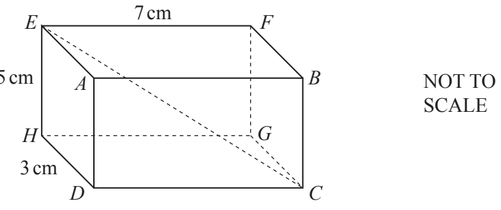
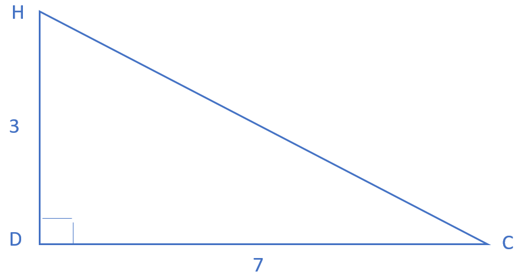
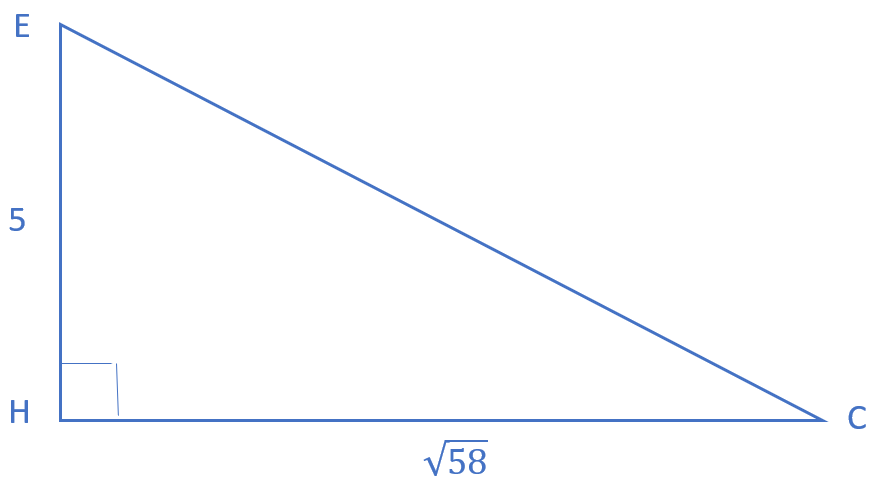
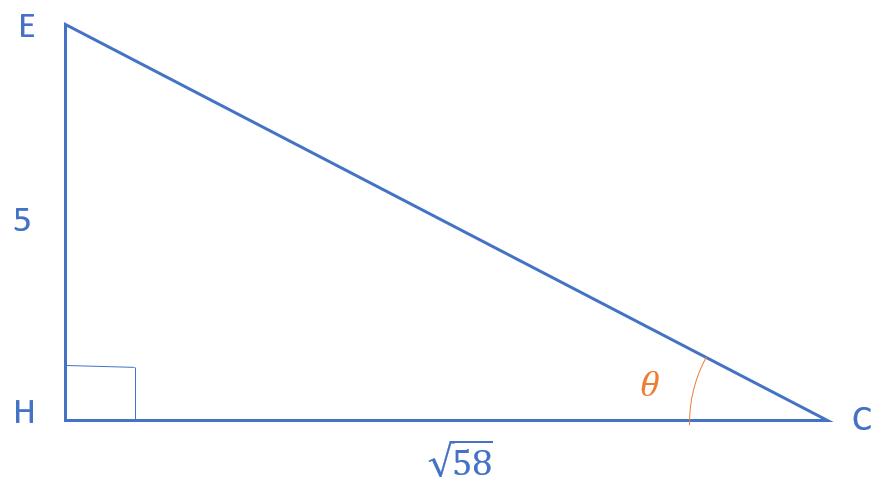

## 3D Pythagoras & Trigonometry

**Question 41:**
 

The diagram shows a cuboid. *HD* = 3 cm, *EH* = 5 cm and *EF* = 7 cm.
Calculate

a)  the length *CE*, (4 marks)

b)  the angle between *CE* and the base *CDHG*. (3 marks)

**
Solution:
**

**Part (a):**

*First consider triangle CHD*
 

*Calculate CH using Pythagoras’*

$$CH^{2} = 3^{3} + 7^{2}$$

$$= 58$$

$$CH = \sqrt{58}$$

*Now consider triangle CHE*
 

*Find CE using Pythagoras’*

$$CE^{2} = 58 + 5^{2}$$

$$= 83$$

$$CE = \sqrt{83}$$

$$= \mathbf{9.11}$$

**Part (b):**

*Considering triangle CHE again*
 

*We now need to calculate angle* $\theta$*. To do this we can use the
tan relation*

$$\tan\theta = \frac{\text{opp}}{\text{adj}}$$

*Using our values*

$$\tan\theta = \frac{5}{\sqrt{58}}$$

$$\theta = \tan^{- 1}\frac{5}{\sqrt{58}}$$

$$= \mathbf{33.3{^\circ}}$$