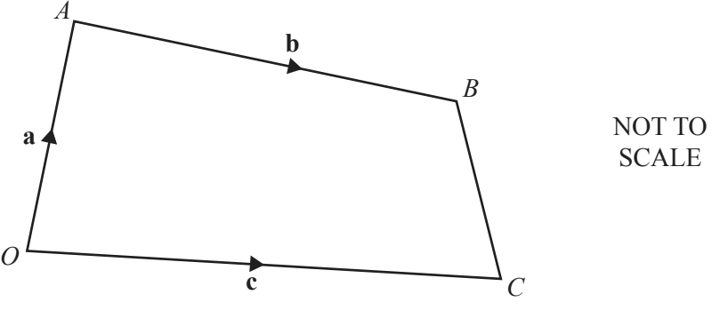
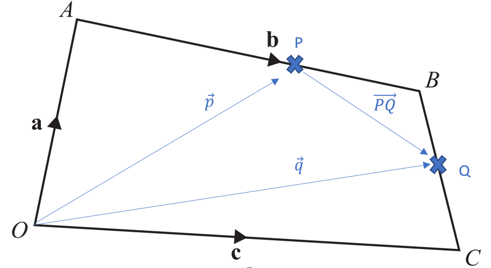

# Matrices and Transformations

## Vectors

**Question 42:**

In the diagram, *O* is the origin, $\overrightarrow{\text{OA }}$=
**a**, $\overrightarrow{\text{OC}}\ $= **c** and$\overrightarrow{\text{AB}}$ = **b**. *P* is on the line *AB* so that
*AP : PB* = 2 : 1. *Q* is the midpoint of *BC*. Find, in terms of **a**,
**b** and **c**, in its simplest form

a)  $\overrightarrow{\text{CB}}$**,** (1 mark)

b)  the position vector of *Q*, (2 marks)

c)  $\overrightarrow{\text{PQ}}$**.** (2 marks)

**
Solution:
**

**Part (a):**

$$
\overrightarrow{\mathbf{\text{CB}}}\mathbf{=}\overrightarrow{\mathbf{a}}\mathbf{+}\overrightarrow{\mathbf{b}}\mathbf{-}\overrightarrow{\mathbf{c}}
$$

**Part (b):**

$$
\overrightarrow{q} = \overrightarrow{c} + \frac{1}{2}\overrightarrow{\text{CB}}
$$

$$
= \overrightarrow{c} + \frac{1}{2}\left( - \overrightarrow{c} + \overrightarrow{a} + \overrightarrow{b} \right)
$$

$$
= \frac{\mathbf{1}}{\mathbf{2}}\mathbf{(}\overrightarrow{\mathbf{a}}\mathbf{+}\overrightarrow{\mathbf{b}}\mathbf{+}\overrightarrow{\mathbf{c}}\mathbf{)}
$$

**Part (c):**

$$
\overrightarrow{\text{PQ}} = - \overrightarrow{p} + \overrightarrow{q}
$$

$$
\overrightarrow{p} = \overrightarrow{a} + \frac{2}{3}\overrightarrow{b}
$$

$$
\rightarrow \overrightarrow{\text{PQ}} = - \overrightarrow{a} - \frac{2}{3}\overrightarrow{b} + \frac{1}{2}\left( \overrightarrow{a} + \overrightarrow{b} + \overrightarrow{c} \right)
$$

$$
\mathbf{= -}\frac{\mathbf{1}}{\mathbf{2}}\overrightarrow{\mathbf{a}}\mathbf{-}\frac{\mathbf{1}}{\mathbf{6}}\overrightarrow{\mathbf{b}}\mathbf{+}\frac{\mathbf{1}}{\mathbf{2}}\overrightarrow{\mathbf{c}}
$$

