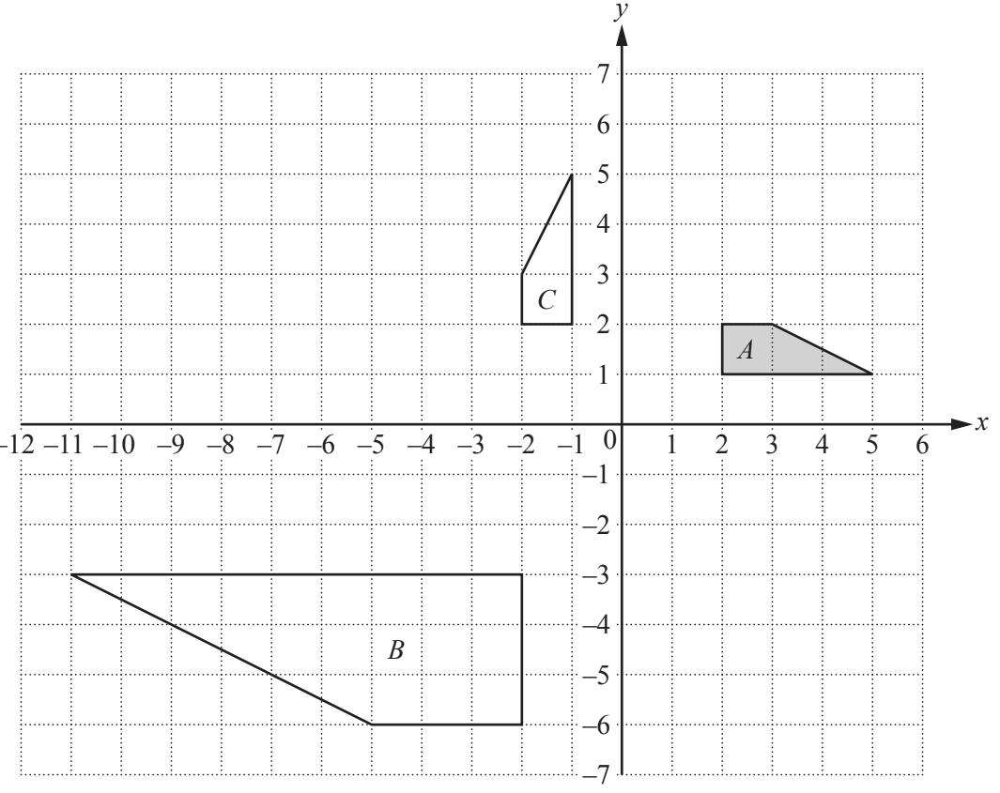
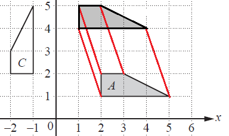
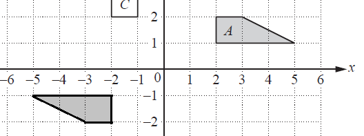
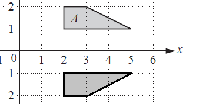
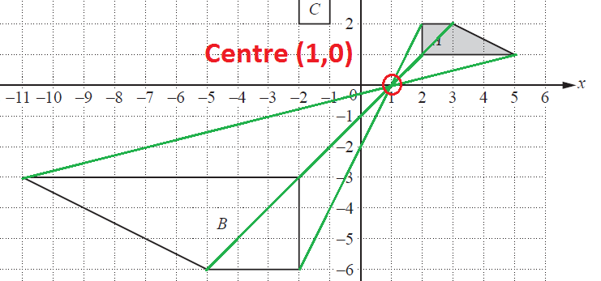

## Transformations (Reflection, Enlargement, Rotation, Translation)

**Question 43:**

a)  Draw the image of
    
i. shape *A* after a translation by $\begin{pmatrix}- 1 \
   3 \
   \end{pmatrix}$, (2 marks)
    
ii.  shape *A* after a rotation through 180° about the point (0, 0), (2 marks)
    
iii.  shape *A* after the transformation represented by the matrix
      $\begin{pmatrix}
      1 & 0 \
      0 & - 1 \
      \end{pmatrix}$ (3 Marks)

&nbsp;

b)  Describe fully the **single** transformation that maps shape *A*
    onto shape *B*. (3 marks)

c)  Find the matrix which represents the transformation that maps shape
    *A* onto shape *C (2 marks)*

**
Solution:
**

**Part (a)(i)**

*This transformation represents a shift by 1 unit in the negative x-
direction and by 3 units in the positive y-direction.*

*The vertices of the new shape are:*

**(1,4), (1,5), (2,5) and (4,4).**

**Part (a)(ii):**

*We rotate the shape by 180°. This is essentially the same as reflecting
the shape in line y=-x.*

*The vertices of the rotated shape are:*

**(-2,-1), (-5,-1), (-2,-2) and (-3,-2).**

**Part (a)(iii):**

*This matrix transformation represents a reflection in the x-axis.*

*The x coordinate does not change, but the y coordinate flips sign.*

$$\begin{pmatrix}
1 & 0 \
0 & - 1 \
\end{pmatrix}\begin{pmatrix}
x \
y \
\end{pmatrix} = \begin{pmatrix}
x \ - y \
\end{pmatrix}$$

*The vertices of the new shape are:*

**(2,-1), (5,-1), (2,-2) and (3,-2).**

**Part (b):**

*When we join the corresponding vertices of shapes A and B, the lines
cross at point (1,0). The distance from (1,0) to a vertex of shape B is
three times as long as the distance from (1,0) to a corresponding vertex
of shape A. This suggests that the scale factor of the enlargement is -3
(minus sign as the lines point in the opposite direction from (1,0)).*

*The transformation is* ***an enlargement with centre (1,0) and the scale
factor -3***.

**Part (c):**

*The transformation that maps shape A onto shape C is a rotation by 90°
in anticlockwise direction.*

*A general matrix for rotation looks like* $\begin{pmatrix}
\cos x & - \sin x \
\sin x & \cos x \
\end{pmatrix}$ *where x is an angle of anticlockwise rotation.*

*This matrix becomes* $\begin{pmatrix}
\mathbf{0} & \mathbf{- 1} \
\mathbf{1} & \mathbf{0} \
\end{pmatrix}\ for\ x = \ 90$