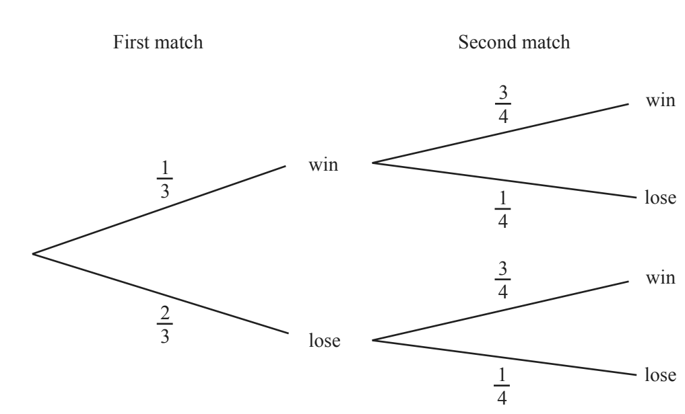
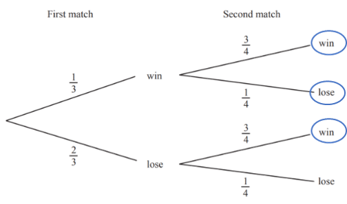

# Probability

## Probability

**Question 45:**

The probability of a cricket team winning or losing in their first two
matches is shown in the tree diagram. Find the probability that the
cricket team wins at least one match. (3 marks)

**
Solution:
**

*The branches that result in at least one win for the cricket team are
circled below:*

*The end probability of each branch is the two probabilities multiplied,
for example the top branch is*

$$\frac{1}{3} \times \frac{3}{4} = \frac{1}{4}$$

*We need to add these probabilities together like so*

$$\frac{1}{3} \times \frac{3}{4} + \frac{1}{3} \times \frac{1}{4} + \frac{2}{3} \times \frac{3}{4}$$

$$= \frac{1}{4} + \frac{1}{12} + \frac{1}{2}$$

$$= \frac{3}{12} + \frac{1}{12} + \frac{6}{12}$$

$$= \frac{10}{12}$$

$$\mathbf{=}\frac{\mathbf{5}}{\mathbf{6}}$$
