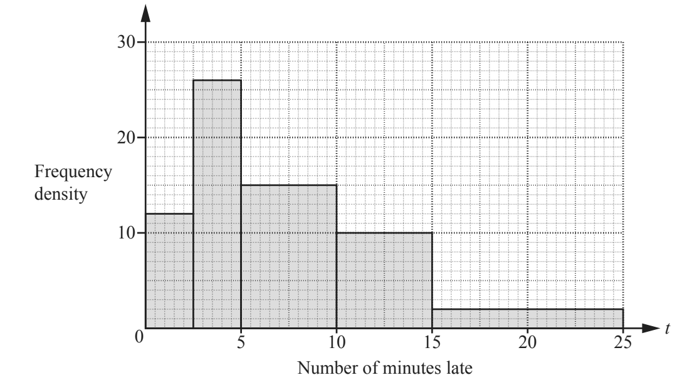

# Statistics

## Histograms, Bar Charts, Pictograms, Scatter Diagrams & Frequency Distributions

**Question 46:**

Deborah records the number of minutes late, *t*, for trains arriving at
a station. The histogram shows this information.

(a) Find the number of trains that Deborah recorded (2 marks)

(b) Calculate the percentage of the trains recorded that arrived more
than 10 minutes late. (2 marks)

**
Solution:
**

**Part (a):**

*We need to add the areas of the rectangles together*

$$12 \times 2.5 + 26 \times 2.5 + 15 \times 5 + 10 \times 5 + 2 \times 10$$

$$= \mathbf{240}$$

**Part (b):**

*Number of trains that arrived more than 10 minutes late is the area of
the last 2 bars*

$$5 \times 10 + 10 \times 2$$

$$= 70$$

*This, as a percentage of the total, is*

$$\frac{70}{240} \times 100\%$$

$$= \mathbf{29.2\%}$$