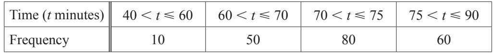
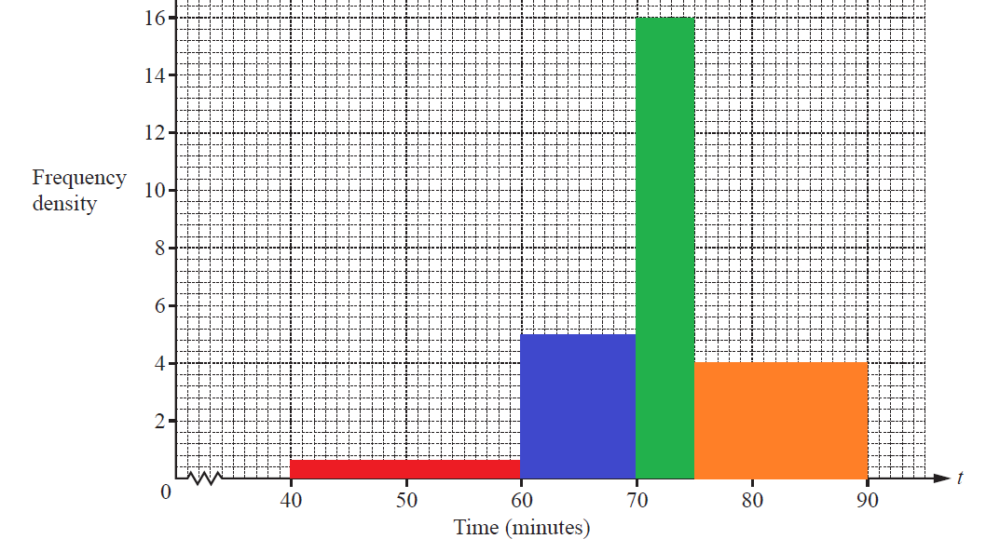

## Grouped Data – Mean/Modal Class & Drawing Histograms

**Question 48:**

The table shows the times, t minutes, taken by 200 students to complete
an IGCSE paper.

a)  By using mid-interval values, calculate an estimate of the mean
    time. (3 marks)

b)  On the grid, draw a histogram to show the information in the table.
    (4 marks)

**
Solution:
**

**Part (a):**

*The mean value is estimated by assuming that the time taken to complete
an IGCSE paper for all students within a given group was equal to the
mid-value of that group*

(i.e. 50min, 65min, 72.5min, 82.5min).

*We sum the products of the mid-value and the frequency of given group
and then divide by the total number of students to get the mean
estimate. The mean is therefore:*

$$mean = \frac{50min \times 10 + 65min \times 50 + 72.5min \times 80 + 82.5min \times 60}{200\ students}$$

$$mean = \mathbf{72.5}\mathbf{\min}$$

**Part (b):**

*To get the right histogram, each bar needs to have an area equal to the
frequency of the given group.*

  - *The width of the first group is 20 and the frequency is 10, so the
    height of the bar is*
    
    10/20**=0.5** (red)

  - *The width of the second group is 10 and the frequency is 50, so the
    height of the bar is*
    
    50/10**=5.0**. (blue)

  - *The width of the third group is 5 and the frequency is 80, so the
    height of the bar is*
    
    80/5**=16**. (green)

  - *The width of the forth group is 15 and the frequency is 60, so the
    height of the bar is*

  - 60/15**=4.0**. (orange)

