## Cumulative Frequency & Frequency Density Diagrams

**Question 49:**

The cumulative frequency diagram shows information about the trunk
diameter, in metres, of 120 trees. Find:

a)  the inter-quartile range, (2 marks)

b)  the 95th percentile, (2 marks)

c)  the number of trees with a trunk diameter greater than 3 metres. (2 marks)

**
Solution:
**

**Part (a):**

*Subtract the lower quartile from the upper quartile (as seen on graph
below)*

$$2.5 - 1$$

$$= \mathbf{1.5}$$

**Part (b):**

*95% of 120 is*

$$0.95 \times 120$$

$$= 114$$

*Read this across and read off corresponding x value*

**Part (c):**

*Read off y-value for 3 metres and subtract this from total number of
trees (120).*

$$120 - 102$$

$$= \mathbf{18}$$