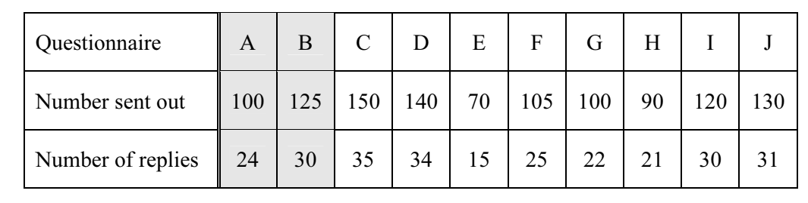
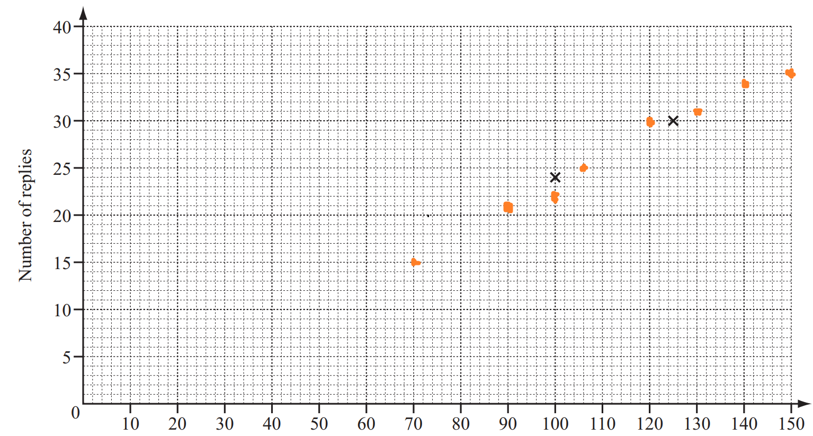
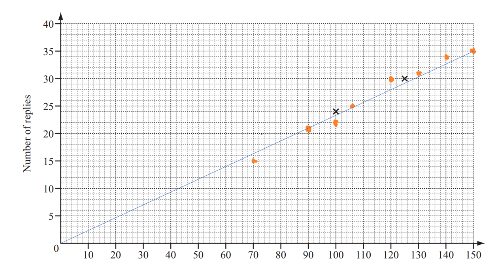

## Correlation

**Question 50:**

A company sends out ten different questionnaires to its customers. The
table shows the number sent and replies received for each questionnaire.

a)  Complete the scatter diagram for these results. The first two points
    have been plotted for you. (2 marks)

b)  Describe the correlation between the two sets of data. (1 mark)

c)  Draw the line of best fit. (1 mark)

**
Solution:
**

**Part (a):**

**Part (b):**

It is **positive** correlation.

*This is because as the number of questionnaires sent out **increases**,
the number of replies also **increases**.*

**Part (c):**

*The line of best fit is drawn in blue*
