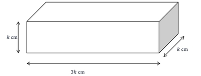
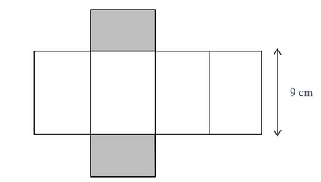
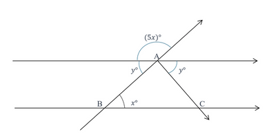
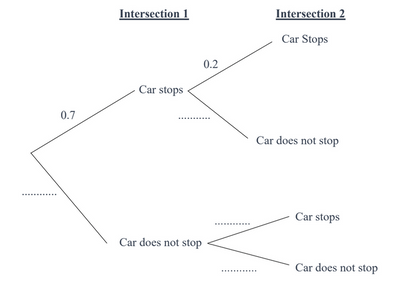
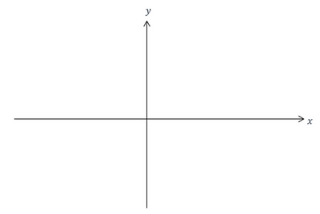
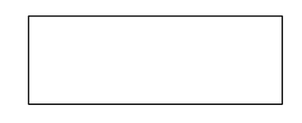
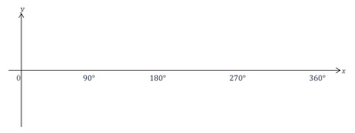

## Paper 21

**Q1**. Work out $\sqrt[3]{64} × 3^2$. $\\_{\text{[2 marks]}}$

$\hspace{1cm}$

**Q2**. Expand $y=\left(2x+5\right)\left(3x+4\right)$. $\\_{\text{[2 marks]}}$

$\hspace{1cm}$

**Q3.** *(a)* Work out the exterior angle of a hexagon.  $\\_{\text{[2 marks]}}$

*(b)* Hence, or otherwise, work out the interior angle of a hexagon.  $\\_{\text{[2 marks]}}$

$\hspace{1cm}$

**Q4.** Find the highest common factor between 36 and 45.  $\\_{\text{[2 marks]}}$

$\hspace{1cm}$

**Q5.** A cuboid with dimensions 3k cm, k cm and k cm is shown below.

The net of the cuboid is also shown below.

*(a)* Find the value of k. $\\_{\text{[2 marks]}}$

*(b)* Find the numerical volume of this cuboid.  $\\_{\text{[2 marks]}}$

$\hspace{1cm}$

**Q6.**

*(a)* Explain, using geometrical reasoning, why angle $x$ and angle $y$ are equal to each other.  $\\_{\text{[1 marks]}}$

*(b)* Show that $y= 30°$.  $\\_{\text{[3 marks]}}$

$\hspace{1cm}$

**Q7.** A recipe for a cake requires ingredients in the following ratios:

A flour to sugar ratio of 3:2

A sugar to butter ratio of 4:1

If the recipe requires 240 grams of sugar, work out how many grams of flour and butter are needed to maintain these ratios.  $\\_{\text{[4 marks]}}$

$\hspace{1cm}$

**Q8.** Work out $\frac{2}{7} - \frac{1}{16}$  $\\_{\text{[6 marks]}}$

$\hspace{1cm}$

**Q9.** Rationalize the denominator of the surd $\frac{4}{2\sqrt{7}+5}$   $\\_{\text{[4 marks]}}$

$\hspace{1cm}$

**Q10.** A 12-hour long flight departs Auckland at 8:20 pm on 4 July and arrives at Los Angeles at 1:20 pm on 4 July.

Work out the time difference between Auckland and Los Angeles.  $\\_{\text{[2 marks]}}$

$\hspace{1cm}$

**Q11.** Saif is planning to open a coffee shop.

He has two main costs: a fixed cost for renting the space and a variable cost for the coffee supplies.

The fixed monthly rent for the shop is 2,200 dollars.

Additionally, each cup of coffee he makes costs 0.30 dollars for the coffee beans and 0.20 dollars for other supplies.

Saif plans to sell each cup of coffee for 2.50 dollars.

*(a)* Write a linear equation that represents Saif’s total monthly cost ($C$) based on the number of cups
of coffee sold ($x$). $\\_{\text{[2 marks]}}$

*(b)* Write a linear equation that represents Saif’s total monthly sales ($S$) based on the number of cups of coffee sold ($x$). $\\_{\text{[1 mark]}}$

*(c)* Saif makes a net profit of 4000 dollars during the month of July. Net profit is the calculated by working out the total sales and deducting the expenditure of the shop.
Work out how much money Saif made in sales during the month of July. $\\_{\text{[4 marks]}}$

$\hspace{1cm}$

**Q12.** An IGCSE mathematics examination had a median score of 63.5% and an interquartile range of 44%.

The examination board has the following grading policy:
• The top 25% of students will receive an A grade or higher.
• The bottom 25% of students will receive a grade lower than an E.

*(a)* If the minimum score required to achieve an A grade is set at 76%, determine the maximum score a student could receive and still get a grade lower than an E. $\\_{\text{[2 marks]}}$

*(b)* The examination board also wants the top 50% of students to receive a B grade.
State the minimum score required to receive a B grade. $\\_{\text{[1 mark]}}$

*(c)* The examination had a mean score of 65%, and 10,000 students took the examination.

A few days after the scripts are marked, the exam board discovered that there was a breach of academic integrity at an exam centre where 200 students cheated and initially received scores of 100%. After being caught, these students' scores were changed to 0%.

Calculate the new average score for the examination after this adjustment. $\\_{\text{[4 marks]}}$

$\hspace{1cm}$

**Q13.** Arrange the numbers below in descending order. $\\_{\text{[2 marks]}}$

$$
\sin(30^{\circ}) \quad \tan(45^{\circ}) \quad \frac{4}{7} \quad \frac{2}{5}
$$

$\hspace{1cm}$

**Q14.** A cylindrical water tank, made of steel, has a radius of 2 meters and a height of 5 meters.

There is a small hole at the bottom of the tank through which water is leaking at a rate of 2$\pi$ cubic meters per hour.

*(a)* Calculate total volume of water the tank can hold when it is full. $\\_{\text{[2 marks]}}$

*(b)* If the tank is initially full, calculate how many hours will it take for the tank to be empty. $\\_{\text{[2 marks]}}$

*(c)* Once the tank is empty, the material of tank is melted in a factory.

The melted metal is then used to make a toy that is shaped to be a hemisphere.
Work out how many hemispheres of diameter 20 cm can be made from the melted metal. $\\_{\text{[5 marks]}}$

$\hspace{1cm}$

**Q15.** Factorise 32 − 8$bt$ − 36$t$ − $bt^2$. $\\_{\text{[2 marks]}}$

$\hspace{1cm}$

**Q16.** The relative velocity, $c$, of an object can be given by the formula:

$$
a = b + c
$$

Where $a$, $b$ and $c$ are velocity vectors.

It is given that $a = \begin{pmatrix} 1 \ 11  \end{pmatrix}$ and $b = \begin{pmatrix} -3 \ 8 \end{pmatrix}$

*(a)* Find 3$a$. $\\_{\text{[1 mark]}}$

The formula $\|c\| = w \|d\|$ gives the angular velocity, $w$, of the object. The vector $d$ represents the displacement of the object. $\|c\|$ and $\|d\|$ represent the magnitude of the vectors $c$ and $d$ respectively.

*(b)* Find the angular velocity of the object if $d = \begin{pmatrix} 0 \ -5 \end{pmatrix}$. $\\_{\text{[4 marks]}}$

$\hspace{1cm}$

**Q17.** Traffic lights at an intersection are controlled in such a way that:

* At the first intersection, there is a 70% chance that a car will have to stop because of a red light.

* If a car stops at the first intersection, there is a 20% chance it will also have to stop at the second intersection.

* However, if a car does not stop at the first intersection, there is a 60% chance it will have to stop at the second intersection.

*(a)* Complete the frequency tree below to represent the scenario above. $\\_{\text{[3 marks]}}$

*(b)* *(i)* Calculate the probability that a car has to stop at both intersections. $\\_{\text{[2 marks]}}$

*(ii)* Calculate the probability that a car stops at either of the intersections. $\\_{\text{[2 marks]}}$

$\hspace{1cm}$

**Q18.** 18 A curve has the equation $y = f(x)$ and it is given that $f(x) = x^3 + 6x^2 + 9x + \pi$.

*(a)* Find an expression for $f^\prime(x)$. $\\_{\text{[4 marks]}}$

*(b)* *(i)* Roughly sketch the graph of $y = f^\prime(x)$.  $\\_{\text{[2 marks]}}$

*(ii)* On your sketch, label the coordinates of the $x$ and $y$ intercepts. $\\_{\text{[3 marks]}}$

*(c)* Find the coordinate of the point where the normal to the curve $y = f^\prime(x)$ is parallel to $y$ – axis. $\\_{\text{[5 marks]}}$

$\hspace{1cm}$

**Q19.** Line $C$ passes through the point $A$(−1,5) and point $B$(2, −7).

*(a)* Work out the coordinates of midpoint of point $A$ and point $B$. $\\_{\text{[2 marks]}}$

*(b)* Find the equation of the perpendicular bisector to line $C$. $\\_{\text{[4 marks]}}$

$\hspace{1cm}$

**Q20.** Draw all the lines of symmetry of the shape shown below.$\\_{\text{[2 marks]}}$

$\hspace{1cm}$

**Q21.** Solve the inequality −3($x + \pi$) < 9.

Give your final answer in terms of $\pi$. $\\_{\text{[3 marks]}}$

$\hspace{1cm}$

**Q22.** Sketch the curve $y = \sin(x) \text{ for } 0^\circ < x < 360^\circ$. $\\_{\text{[1 mark]}}$

$\hspace{1cm}$

**Q23.** The table below shows some of the terms in sequences *A*, *B*, and *C*.

Complete the table. $\\_{\text{[6 marks]}}$

#|
||

Sequence

|

1st term

|

2nd term

|

3rd term

|

4th term

|

5th term

|

nth term

||
||

A

|

5

|

a

|

13

|

a

|

29

|

n2+4

||
||

B

|

-2

|

0

|

a

|

4

|

6

|

2n-4

||
||

C

|

7

|

8

|

11

|

a

|

a

|

a

||
|#

