## Paper 22

**Q1.** *(a)* Write down the appropriate equations in the boxes for the graphs shown below. $\\_{\text{[2 marks]}}$

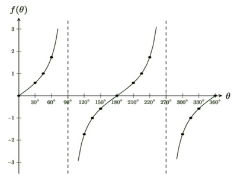

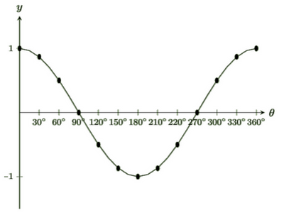

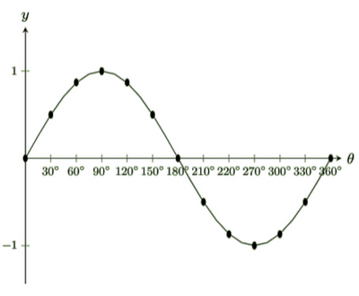

*(b)* On the graphs below, label the maximum points as $M$ and minimum points as $X$. $\\_{\text{[5 marks]}}$

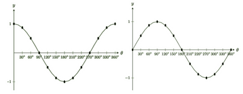

*(c)* State the exact value of $\frac{5}{7}\sin(450^{\circ}) - \frac{4}{7}\cos(540^{\circ} + \tan^3(45^{\circ})$. $\\_{\text{[4 marks]}}$

$\hspace{1cm}$

**Q2.** $a = a\_0 + jt$ is a formula that links acceleration, time and jerk together.

Given that an object at time, $t = 4$ s had $a\\_0  = 5 \text{m/s}^2$ and has $a = 7\text{m/s}^2$, calculate the jerk, $j$, of the object with correct units.  $\\_{\text{[3 marks]}}$

$\hspace{1cm}$

**Q3.** It is given that $x$ and $y$ are two different prime numbers.

*(a)* Find the HCF (Highest Common Factor) of $x$ and $y$. $\\_{\text{[1 mark]}}$

*(b)* Find the LCM (Least Common Multiple) of $x$ and $y$. $\\_{\text{[1 mark]}}$

$\hspace{1cm}$

**Q4.** A length is measured as 5 meters, correct to the nearest meter.
State the upper bound and lower bound for this length. $\\_{\text{[2 marks]}}$

$\hspace{1cm}$

**Q5.** On a cold day in Pittsburg, the temperature was 8 °C during the day. During nighttime, the temperature drops down to −8 °C.
Calculate the temperature difference between the daytime and nighttime. $\\_{\text{[1 mark]}}$

$\hspace{1cm}$

**Q6.** The University of Cambridge campus spans an area of 6,170,000 m$^2$.

Work out how much the University of Cambridge campus spans in an area of km$^2$ $\\_{\text{[1 mark]}}$

$\hspace{1cm}$

**Q7.** Express $\sqrt{63}$ in the form $k\sqrt{n}$, where $k$ and $n$ are positive integers. $\\_{\text{[2 marks]}}$

$\hspace{1cm}$

**Q8.** At X Notes, a company dedicated to educational content creation, there are three types of roles:
Contributors, Interns, and Ambassadors. In the company, the number of Contributors to Interns follows a ratio of 3:2, and the number of Interns to Ambassadors follows a ratio of 2:1.
In total, there are 300 individuals across all three roles.

*(a)* Calculate the number of individuals in each role. $\\_{\text{[4 marks]}}$

*(b)* An individual is chosen at random from the Contributors and another individual is chosen at random from the Ambassadors.

Calculate the probability that both chosen individuals are from Asia, given that there are 50 contributors, 30 Interns, and 20 Ambassadors that are from the Asia. $\\_{\text{[3 marks]}}$

*(c)* Complete the pie chart to represent the number of people in different roles who are from Asia.

Label each sector of the pie chart with the role type it represents and the angle of that sector. $\\_{\text{[3 marks]}}$

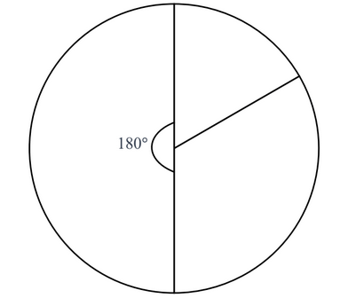

*(d)* *(i)* An ambassador at X notes gets paid 600 dollar monthly and works 10 hours per week.
Assuming that there are 4 weeks (or 28 days) in a month, work out the hourly salary rate of an ambassador at X notes. $\\_{\text{[3 marks]}}$

*(ii)* The interns have an hourly pay rate that is 1.5 times more than ambassadors. An intern works the same amount of time as an ambassador.

Work out the weekly salary of an intern. $\\_{\text{[3 marks]}}$

$\hspace{1cm}$

**Q9.** Work out the exact cross-sectional area of a hemisphere with radius 7 cm. $\\_{\text{[2 marks]}}$

$\hspace{1cm}$

**Q10.** It is given that $3^n + 3^n + 3^n+ 3^n + 3^n + 3^n + 3^n + 3^n + 3^n = 3^m$

Find $m$ in terms of $n$. $\\_{\text{[2 marks]}}$

$\hspace{1cm}$

**Q11.** Given that $3a + \frac{1}{3a} = 2$, determine the value of a $9a^2 + \frac{1}{9a^2} + 2$ without solving for $a$. $\\_{\text{[2 marks]}}$

$\hspace{1cm}$

**Q12.** Complete the statements below.

It is given that $(y - 5)$ is directly proportional to $x$. When the graph of $(y - 5)$ is plotted against $x$, it is a ................................... line with a gradient of $\frac{1}{2}$.

When $y$ is plotted against $x$, it has the equation ...................................................... $\\_{\text{[3 marks]}}$

$\hspace{1cm}$

**Q13.**

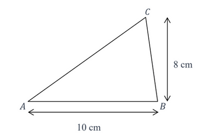

*(a)* Work out the area of the triangle $ABC$ shown above. $\\_{\text{[2 marks]}}$

*(b)* State the number of lines of symmetry of the triangle $ABC$ above. $\\_{\text{[2 marks]}}$

*(c)* The triangle $XYZ$ is a similar triangle to triangle $ABC$.

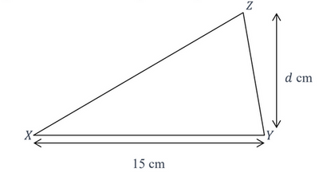

Work out the area of triangle $XYZ$. $\\_{\text{[3 marks]}}$

*(d)* Triangle $ABC$ and triangle $EFG$ are plotted on the grid below.

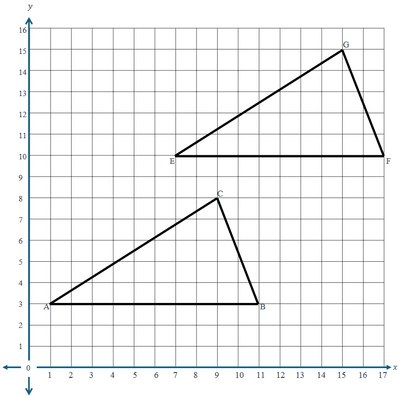

(i) Describe fully, the single transformation that occurs when triangle $ABC$ is transformed to triangle $XYZ$. $\\_{\text{[2 marks]}}$

(ii) Work out the exact distance moved by each point when triangle $ABC$ is transformed to triangle $XYZ$. $\\_{\text{[2 marks]}}$

$\hspace{1cm}$

**Q14.** Simplify $\frac{ax - b + x  - ab}{ax^2 - abx}$ ensuring that your final answer is in terms of $a$ and $abx$ only. $\\_{\text{[5 marks]}}$

$\hspace{1cm}$

**Q15.** Write down 7,510,000 in standard form. $\\_{\text{[1 mark]}}$

$\hspace{1cm}$

**Q16.** The denominator of a **positive fraction** is 1 more than the numerator.

The sum of the **positive fraction** and its reciprocal is $\frac{5}{2}$

Find the **positive fraction**. $\\_{\text{[5 marks]}}$

$\hspace{1cm}$

**Q17.** The graph below has the equation $y = a(x +b)^2 + c$.

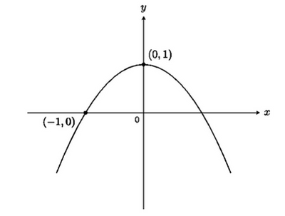

Work out the value of $a$, $b$ and $c$. $\\_{\text{[4 marks]}}$

$\hspace{1cm}$

**Q18.** The mass, correct to the nearest kilogram, of each of the 11 packets of rice is shown below.

$$
7 \quad 6 \quad 10 \quad 26 \quad 9 \quad 11 \quad 10 \quad 11 \quad 12 \quad 16 \quad 11
$$

(a) Find the mode. $\\_{\text{[1 mark]}}$

(b) Find the median. $\\_{\text{[2 marks]}}$

(c) Give a reason why the mean would be an unsuitable average to use. $\\_{\text{[1 mark]}}$

$\hspace{1cm}$

**Q19.**

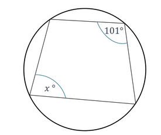

Work out the value of $x$. $\\_{\text{[2 marks]}}$

$\hspace{1cm}$

**Q20.**

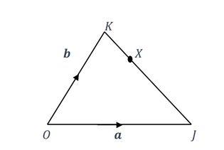

$OKJ$ is a triangle.

$X$ is a point on $KJ$ so that $KX$ : $XJ$ = 1 : 5.
$O$ is the origin, $\vec{OJ}$ = **a** and $\vec{OK}$ = **b**.

Find the position vector of $X$.
Give your answer in terms of **a** and **b** in its simplest form. $\\_{\text{[3 marks]}}$

$\hspace{1cm}$

**Q21.** Factorise $x^2 + 6x + 5$. $\\_{\text{[2 marks]}}$

$\hspace{1cm}$

**Q22.** Find the set of values of *h* such that:

* the perimeter of the trapezium below is 50 cm

- the area spanned by the trapezium is greater than 50 cm$^2$. $\\_{\text{[4 marks]}}$

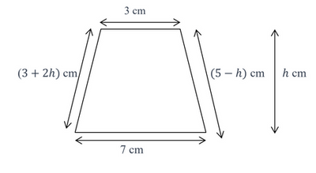

$\hspace{1cm}$

**Q23.** The net of a cylinder is shown below.

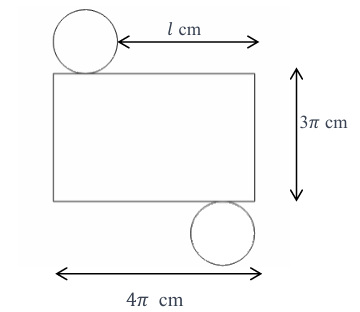

(a) Work out the exact value of the length, $l$ cm.  $\\_{\text{[3 marks]}}$

(b) Work out the surface area of this cylinder in terms of $\pi$. $\\_{\text{[3 marks]}}$

(c) Work the volume of this cylinder in terms of $\pi$. $\\_{\text{[2 marks]}}$

$\hspace{1cm}$

**Q24.** Aaryan oscillates a string.
A horizontal line intersects the piece of the string Aaryan is oscillating at 4 points and divides it into five parts, as shown below.

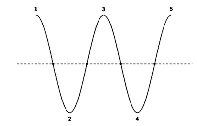

If the piece of string is intersected in this way by 19 parallel lines, each of which intersects it at
4 points, determine the number of parts into which the string will be divided. $\\_{\text{[4 marks]}}$