## Paper 23

**Q1.** Work out $9^2$ × $\sqrt[3]{8}$. $\\_{\text{[2 marks]}}$

$\hspace{1cm}$

**Q2.** Solve the equation $7(x + 5) = 49$. $\\_{\text{[2 marks]}}$

$\hspace{1cm}$

**Q3.** Find the bearing of $A$ from $B$ if the bearing of $B$ from $A$ is 125°. $\\_{\text{[2 marks]}}$

$\hspace{1cm}$

**Q4.** Convert 100 m$^2$ in cm$^2$.  $\\_{\text{[2 marks]}}$

$\hspace{1cm}$

**Q5.** Simplify $(4x^3)^2$.  $\\_{\text{[2 marks]}}$

$\hspace{1cm}$

**Q6.** A set of 9 numbers is shown below.

$$
3 \quad 5 \quad 6 \quad 3 \quad 8 \quad 9 \quad 1 \quad 7 \quad 3
$$

For the numbers shown above, calculate the:

*(a)* Mean $\\_{\text{[2 marks]}}$

*(b)* Median $\\_{\text{[2 marks]}}$

*(c)* Mode $\\_{\text{[1 mark]}}$

*(d)* Range $\\_{\text{[2 marks]}}$

$\hspace{1cm}$

**Q7.** State if the following numbers below are irrational or rational.

*(a)* 0.17̇ $\\_{\text{[1 mark]}}$

*(b)* $3\pi$ $\\_{\text{[1 mark]}}$

$\hspace{1cm}$

**Q8.** It is given that:

A =

B =

Complete the Venn diagram below to represent set A and B. $\\_{\text{[2 marks]}}$

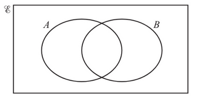

$\hspace{1cm}$

**Q9.** Work out $2\frac{5}{8} \div \frac{3}{4}$

Give your answer as a mixed fraction. $\\_{\text{[3 marks]}}$

$\hspace{1cm}$

**Q10.** *(a)* Work out the exterior angle of an octagon. $\\_{\text{[1 mark]}}$

*(b)* Hence, or otherwise, work out the interior angle of an octagon. $\\_{\text{[1 mark]}}$

$\hspace{1cm}$

**Q11** As the temperature decreases, people eat less ice cream.

What type of correlation does this statement describe? $\\_{\text{[1 mark]}}$

$\hspace{1cm}$

**Q12.** The trapeziums shown below are similar shapes.

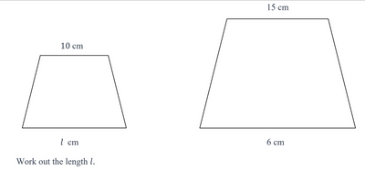

Work out the length $l$.  $\\_{\text{[2 marks]}}$

$\hspace{1cm}$

**Q13.** By writing each number correct to 1 significant figure, estimate the value of: $\\_{\text{[2 marks]}}$

$$
\frac{51.9}{9.89 × 0.541}
$$

$\hspace{1cm}$

**Q14.** $f(x) = \frac{1}{2}x + 5 \qquad g(x) = x^2 \qquad h(x) = 3^x$

*(a)* Work out $f^{-1}(x)$.  $\\_{\text{[3 marks]}}$

*(b)* Work out $fg(4)$.  $\\_{\text{[3 marks]}}$

*(c)* Find $x$ when $h^{-1}(x) = 2$.  $\\_{\text{[2 marks]}}$

$\hspace{1cm}$

**Q15.** Express $\sqrt{98}$ in the form $a\sqrt{b}$ where $a$ is an odd integer but $b$ is an even integer.  $\\_{\text{[2 marks]}}$

$\hspace{1cm}$

**Q16.** The 2D net of a cone is shown below.

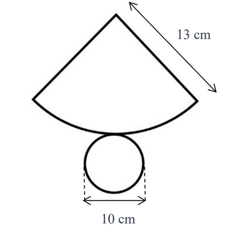

Work out the volume of this cone.  $\\_{\text{[4 marks]}}$

$\hspace{1cm}$

**Q17.** Make $x$ the subject of the equation $x = \frac{(y + 2)^2}{4}$.  $\\_{\text{[3 marks]}}$

$\hspace{1cm}$

**Q18.** The government lends $50,000 as a student loan on simple interest to a student.

The government wants the loan to be repaid in 10 years and wants to make $500 in interest during this period.

Work out the rate of interest (per year) that the student has to pay.  $\\_{\text{[2 marks]}}$

$\hspace{1cm}$

**Q19.** The speed-time graph for a cyclist riding his bike is shown below.

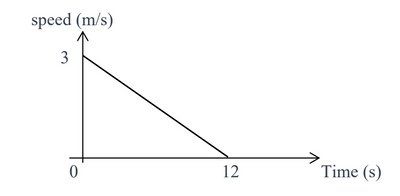

*(a)* Calculate the acceleration of the cyclist.  $\\_{\text{[2 marks]}}$

*(b)* Calculate the distance covered by the cyclist.  $\\_{\text{[2 marks]}}$

*(c)* The formula $v\\_f = v\\_i + a\\_{i}t \frac{1}{2}jt^2$ links velocity, acceleration, jerk, and time.

The table below shows what symbol each quantity in the formula above has.

#|
||

**Symbol**

|

**Quantity represented by symbol**

||
||

$v\_f$

|

Final Velocity of cyclist

||
||

$v\_i$

|

Initial Velocity of cyclist

||
||

$a\_i$

|

Initial acceleration of cyclist

||
||

$t$

|

Time taken for the journey

||
||

$j$

|

Jerk

||
|#

Use the graph and formula to calculate how much jerk the cyclist has.

State the unit of jerk at the end of your answer.  $\\_{\text{[4 marks]}}$

$\hspace{1cm}$

**Q20.** Label the minimum point as $M$ and maximum point as $X$ for the graph shown below.  $\\_{\text{[2 marks]}}$

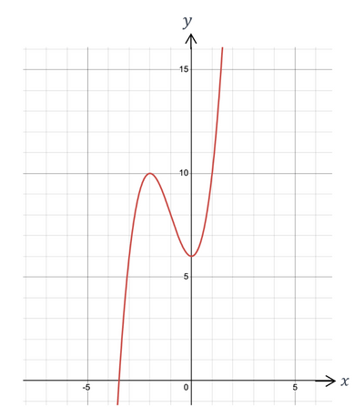

$\hspace{1cm}$

**Q21.**

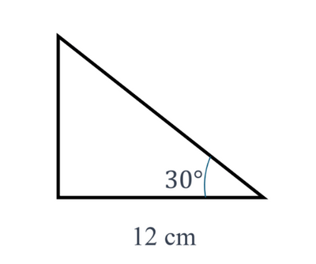

*(a)* Work out the area of the triangle above.  $\\_{\text{[4 marks]}}$

*(b)* The formula $\frac{1}{2}ab\sin{\theta}$ can be used to calculate the area of any triangle.

Explain why the formula $\frac{1}{2}ab$, where $a$ is a base and $b$ is the height of triangle can also be used to
calculate areas for right-angled triangles.  $\\_{\text{[2 marks]}}$

$\hspace{1cm}$

**Q22.** Find the Highest Common Factor (HCF) of 91 and 65.  $\\_{\text{[2 marks]}}$

$\hspace{1cm}$

**Q23.**

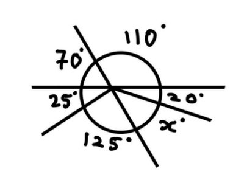

Work out the value of $x$.  $\\_{\text{[2 marks]}}$

$\hspace{1cm}$

**Q24.** Ashmit takes a local train to attend his university lectures. The probability that the local train is late on any given day is $\frac{1}{5}$. If the train is late, Ashmit is late for his lectures.

*(a)* Complete the tree diagram for Ashmit being late for his lectures on Monday and Tuesday.  $\\_{\text{[2 marks]}}$

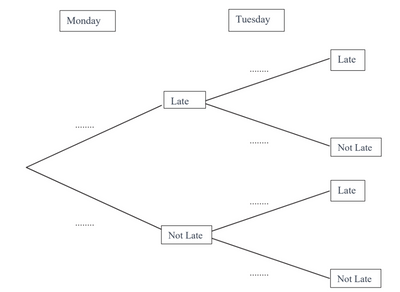

*(b)* Calculate the probability that Ashmit arrives on time for his lectures on both Monday and Tuesday.  $\\_{\text{[2 marks]}}$

*(c)* Ashmit’s professor likes to ride a unicycle and juggle. If he covers the lecture content faster than usual, he shows everyone how he juggles and ride his unicycle in front of the whole class at the end of the lecture.

The probability that he covers the lecture content faster than usual is $\frac{2}{7}$.

Calculate the probability that Ashmit does not see his lecturer doing a unicycling and juggling demonstration.  $\\_{\text{[1 mark]}}$

$\hspace{1cm}$

**Q25.** Write down an expanded expression, with 3 terms, for cross-sectional area of a sphere with radius ($2r$ + 5) cm.  $\\_{\text{[2 marks]}}$

$\hspace{1cm}$

**Q26.** A line $B$ passes through point $X$ at (3,5) and point $Y$ at (4,7).

*(a)* Work out the coordinates of the midpoints between points $X$ and $Y$.  $\\_{\text{[2 marks]}}$

*(b)* Work out the length of the line connecting points $X$ and $Y$.  $\\_{\text{[3 marks]}}$

*(c)* Work out the equation of the perpendicular bisector to line $B$.  $\\_{\text{[5 marks]}}$

$\hspace{1cm}$

**Q27.**

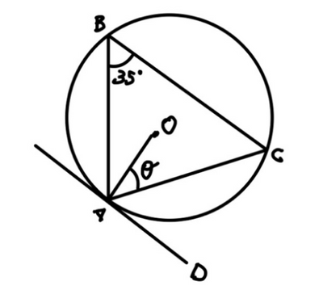

*(a)* Work out the value of $\theta$.  $\\_{\text{[2 marks]}}$

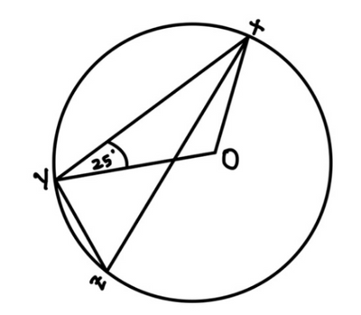

*(b)* *(i)* Using geometrical reasons, explain why angle $XOY$, in the figure above, is 130°.  $\\_{\text{[3 marks]}}$

*(ii)* Using geometrical reasons, explain why angle $XZY$, in the figure above, is 65°.  $\\_{\text{[1 mark]}}$

$\hspace{1cm}$

**Q28** The rectangle below can have a minimum area of 100 cm2 but must have a maximum perimeter of 50 cm.

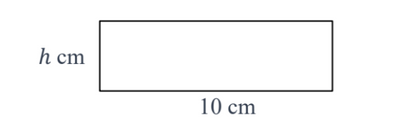

Work out the set of possible values for the height, *h*, of the rectangle.  $\\_{\text{[4 marks]}}$

$\hspace{1cm}$

**Q29** Factorise $8(k + g)^2 + 24(k + g)$.  $\\_{\text{[2 marks]}}$