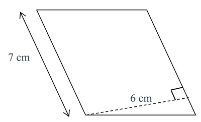
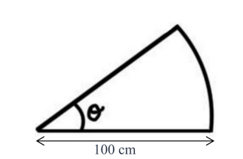
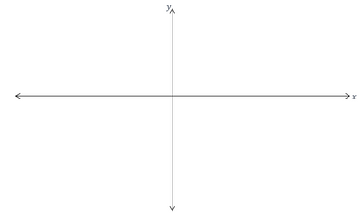
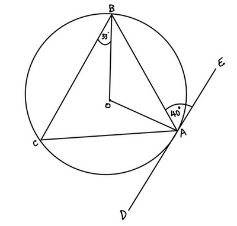

## Paper 24

**Q1.** A list of numbers is shown below.

$$
16 \qquad 17 \qquad 22 \qquad 20 \qquad 15\qquad
$$

*(a)* From the list above, identify:

*(i)* a prime number.  $_{\text{[1 mark]}}$

*(ii)* a square number.  $_{\text{[1 mark]}}$

*(iii)* a multiple of 11.  $_{\text{[1 mark]}}$

*(iv)* a solution to the equation $x^2 = 255$.  $_{\text{[1 mark]}}$

*(b)* For the list of numbers, calculate their:

*(i)* mean  $_{\text{[2 marks]}}$

*(ii)* median  $_{\text{[2 marks]}}$

*(iii)* range  $_{\text{[2 marks]}}$

$\hspace{1cm}$

**Q2** List out all the factors of 78.  $_{\text{[2 marks]}}$

$\hspace{1cm}$

**Q3.** *(a)* Find the highest common factor of 52 and 78.  $_{\text{[2 marks]}}$

*(b)* A student scores 52 marks out of 78 in his math test.

What percentage does he score?  $_{\text{[2 marks]}}$

$\hspace{1cm}$

**Q4.**

Work out the area of the parallelogram above.  $_{\text{[2 marks]}}$

$\hspace{1cm}$

**Q5.** The resultant force acting on an object is calculated by adding the vectors ***b*** = $\begin{pmatrix} 7 \ -9  \end{pmatrix} $ and ***c*** =$\begin{pmatrix} -2 \ -3  \end{pmatrix}$

*(a)* Find the magnitude of the resultant force acting on the object.  $_{\text{[4 marks]}}$

*(b)* The equation $\|F\| = m\|a\|$, where $\|F\|$ is the magnitude of the resultant force and $\|a\|$ is the magnitude of the acceleration acting on the object.

If $\|m = 2\|$, work out the magnitude of the acceleration acting on the object.  $_{\text{[2 marks]}}$

$\hspace{1cm}$

**Q6.** Make $x$ the subject of the formula $y = (x - 1)^5 + 5$.  $_{\text{[2 marks]}}$

$\hspace{1cm}$

**Q7** Work out the exact gradient of the line with the equation $17x + 5y = 9$.$_{\text{[2 marks]}}$

$\hspace{1cm}$

**Q8.**

A sector with an arc length of 0.2$\pi$m, radius 100 cm and angle $\theta$° is shown above.

*(a)* Show that $\theta$ = 36°.  $_{\text{[3 marks]}}$

*(b)* Find the exact perimeter of the sector.  $_{\text{[3 marks]}}$

*(c)* Find the exact area of the sector.  $_{\text{[2 marks]}}$

$\hspace{1cm}$

*Q9.* Workout $\frac{3}{4} + \frac{2}{3}$

Give your answer as a mixed fraction.  $_{\text{[3 marks]}}$

$\hspace{1cm}$

**Q10** Work out the volume of a cuboid with length 5 cm, height 10 cm and width 3 cm.  $_{\text{[2 marks]}}$

$\hspace{1cm}$

**Q11** Rationalize the denominator for the surd $\frac{7}{6\sqrt{3} + 5}$  $_{\text{[4 marks]}}$

$\hspace{1cm}$

**Q12** State the exact value of

*(a)* $\sin{45^\circ}_{\text{[1 mark]}}$

*(b)* $\tan{60^\circ}_{\text{[1 mark]}}$

$\hspace{1cm}$

**Q13** It is given that $f(x) = -(x -2)(x + 1)^2$.

*(a)* Find the coordinates where $f(x)$ crosses the $x$ axis.  $_{\text{[2 marks]}}$

*(b)* Show that $f(x) = -x^3 + 3x + 2$.  $_{\text{[3 marks]}}$

*(c)* *(i)* Find the coordinates of stationary point on the curve $y = f(x)$.  $_{\text{[7 marks]}}$

*(ii)* Classify the nature of each stationary point on the curve $y = f(x)$.  $_{\text{[3 marks]}}$

*(d)* *(i)* Sketch the graph of $y = f(x)$.  $_{\text{[2 marks]}}$

*(ii)* On your sketch, label the **coordinates** of the $x$ and $y$ intercepts.  $_{\text{[2 marks]}}$

*(e)* Find $x$ when $f^{-1}(x) = 3$.  $_{\text{[2 marks]}}$

$\hspace{1cm}$

**Q14** The bearing of point $A$ from $B$ is 060°.
Work out the bearing of point $B$ from point $A$.  $_{\text{[2 marks]}}$

$\hspace{1cm}$

**Q15** *(a)* Work out the interior angle of a dodecagon (12-sided polygon).  $_{\text{[1 mark]}}$

*(b)* Hence, work out the exterior angle of a dodecagon (12-sided polygon).  $_{\text{[1 mark]}}$

$\hspace{1cm}$

**Q16.** Point $A$ has the coordinates (3,1) and point $B$ has coordinates (-5,10).
Work out the coordinates of the midpoint between point $A$ and $B$.  $_{\text{[2 marks]}}$

$\hspace{1cm}$

**Q17** Simplify $\frac{x^2 - 2x}{x^4 - 16}$.  $_{\text{[4 marks]}}$

$\hspace{1cm}$

**Q18.** Ashmit invests $500 in a savings account that offers a simple annual interest rate of 2%.

Calculate how much interest will Ashmit earn after 5 years.  $_{\text{[2 marks]}}$

$\hspace{1cm}$

**Q19.**

Points $A$, $B$ and $C$ lie on the circle with center $O$, as shown above.

*(a)* Find angle $OAB$, giving a geometrical reason to support your answer.

Angle $OAB$ = ................................................................
because ................................................................................................................................   $_{\text{[2 marks]}}$

*(b)* Find angle $AOB$.  $_{\text{[2 marks]}}$

*(c)* Find angle $BCA$, giving a geometrical reason to support your answer.

Angle $BCA$ = ................................................................
because ................................................................................................................................   $_{\text{[2 marks]}}$

*(d)* Find angle $AOB$.  $_{\text{[2 marks]}}$

$\hspace{1cm}$

**Q20** Ashmit buys $x$ bags of chocolates and $y$ bags of lollies. The cost of each bag of chocolates is $c$ dollars and each bag of lollies costs $l$ dollars.

Ashmit pays with a $20 note.

*(a)* Write down an expression, in terms of $x$, $y$, $c$ and $l$, for the total cost of the chocolates and lollies that Ashmit buys.  $_{\text{[2 marks]}}$

*(b)* Write down an expression, in terms of $x$, $y$, $c$ and $l$, for the amount of change Ashmit receives from the 20 dollar note after buying the chocolates and lollies.  $_{\text{[1 mark]}}$

*(c)* Ashmit decides to buy 2 bags of chocolates and 3 bags of lollies, he spends 9 dollars on all the chocolate bags he buys and receives 5 dollars as change.

Work out the cost of each bag of chocolate and each bag of lollie.  $_{\text{[4 marks]}}$

*(d)* A bag of chocolate consists of 3 milk chocolate bars, 1 white chocolate bar and 1 of dark chocolate bar.

Ashmit opens the 2 bags of chocolate he bought and randomly takes a piece of chocolate.

What is the probability that Ashmit receives a milk chocolate bar from both the bags.  $_{\text{[2 marks]}}$

$\hspace{1cm}$

**Q21.** The table below shows information about the times, $t$ seconds, taken by each of 100 students to eat
one Tim Tam (a chocolate biscuit).

#|
||

Time ($t$ seconds)

|

$0< t\le 1$

|

$1< t\le 3$

|

$4< t\le 6$

|

$5< t\le 7$

|

$7< t\le 9$

||
||

Frequency

|

10

|

42

|

26

|

18

|

4

||
|#

Ashmit draws a histogram to show the information.

The table below shows the heights, in cm, of some of the bars for this histogram.  $_{\text{[3 marks]}}$

#|
||

Time ($t$ seconds)

|

$0< t\le 1$

|

$1< t\le 3$

|

$4< t\le 6$

|

$5< t\le 7$

|

$7< t\le 9$

||
||

Frequency

|

20

|

42

|

__

|

6

|

__

||
|#

