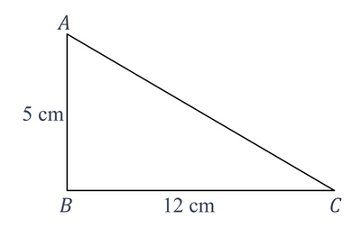
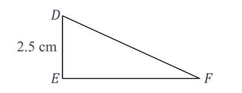
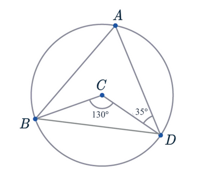

## Paper 25

**Q1.** Expand and simplify ($x$ + 6)($x$ − 4). $_{\text{[2 marks]}}$

$\hspace{1cm}$

**Q2.** Factorise $4(x - 5b) + bx(x -5b)$. $_{\text{[2 marks]}}$

$\hspace{1cm}$

**Q3.** Add the inequality signs (> or <) to make the statements below correct. $_{\text{[2 marks]}}$

$$
\frac{3}{4}................\pi \\\
0\.6................6%
$$

$\hspace{1cm}$

**Q4.** Work out the equation of the line that passes through the points (3,5) and (5,9). $_{\text{[4 marks]}}$

$\hspace{1cm}$

Error correction: Unlike what is written in the drive mark scheme, the solution for this question is "y=2x-1"

**Q5.** In terms of $\pi$, work out the area of a semicircle with radius 5 cm.

$\hspace{1cm}$

**Q6.** Add relevant brackets in the correction places to make the equation below correct. $_{\text{[1 mark]}}$

$$
8 \quad ÷ \quad 2 \quad × \quad 2 \quad + \quad 2 \quad = \quad 1
$$

$\hspace{1cm}$

**Q7.** Work out the perimeter of a square that has an area of 49 m$^2$. $_{\text{[3 marks]}}$

$\hspace{1cm}$

**Q8.** Work out $\sqrt[3]{125} \times 6^2$. $_{\text{[2 marks]}}$

$\hspace{1cm}$

**Q9.** State the exact value of $tan(60°)$. $_{\text{[1 mark]}}$

$\hspace{1cm}$

**Q10.** Write down $4\frac{3}{4}$ as an improper fraction. $_{\text{[1 mark]}}$

$\hspace{1cm}$

**Q11.**

*(a)* Work out the length $AC$. $_{\text{[2 marks]}}$

*(b)* Work out the area of triangle $ABC$. $_{\text{[2 marks]}}$

*(c)* Work out the perimeter of triangle $ABC$. $_{\text{[2 marks]}}$

Triangle $DEF$ is similar to triangle $ABC$.

*(d)* Work out the value of length $EF$. $_{\text{[2 marks]}}$

*(e)* State if the following statements are true or false.

Length $DF$ = Length $AC_{\text{[1 mark]}}$

Angle $DFE$ = Length $ACB_{\text{[1 mark]}}$

$\hspace{1cm}$

**Q12.** Simplify the ratio $2^30 : 2^32 : 2^34_{\text{[2 marks]}}$.

$\hspace{1cm}$

**Q13.** Convert the recurring number $0.5\dot{6}$ into a fraction. $_{\text{[2 marks]}}$

$\hspace{1cm}$

**Q14.** Convert 100 m$^2$ into km$^2$.$_{\text{[1 mark]}}$

$\hspace{1cm}$

**Q15.** At Shauraya’s birthday party, a piñata filled with chocolates is broken by Shauraya, and all the guests
collect as many chocolates as they can. The masses of the bags of chocolates (in grams)collected by 6 guests are as follows:

$$
50 \qquad 55 \qquad 35 \qquad 50 \qquad 28 \qquad 22
$$

*(a)* Calculate the mean mass of the chocolate bags collected by these guests. $_{\text{[2 marks]}}$

*(b)* Calculate the median mass of the chocolate bags collected by these guests. $_{\text{[2 marks]}}$

*(c)* Calculate the range of the masses of the chocolate bags collected by these guests. $_{\text{[2 marks]}}$

$\hspace{1cm}$

**Q16.** Given that $y = (\frac{2\pi x}{3})^\frac{2}{3\pi} + 5x^3$, find $\frac{\text{dy}}{\text{dx}}_\text{[3 marks]}$

$\hspace{1cm}$

**Q17.** Solve the equation $\frac{1}{2} + x^2 = \frac{33}{16}$ without using the quadratic formula. $_{\text{[4 marks]}}$

$\hspace{1cm}$

**Q18.** Rationalise the denominator for the surd $\frac{4}{\sqrt{7} + 5}_{\text{[4 marks]}}$

$\hspace{1cm}$

**Q19.**

*(a)* Work out angle $BAD$, giving a geometrical reason for your answer.

Angle $BAD$ = ...................................

Reason = ............................................................................................................................................ $_{\text{[2 marks]}}$

*(b)* Work out angle $ABC$. $_{\text{[3 marks]}}$

*(c)* Work out angle $ABD$. $_{\text{[2 marks]}}$

*(d)* Identify the type of triangle that triangle $ADB$ is. $_{\text{[1 mark]}}$

$\hspace{1cm}$

**Q20.** Jo and Mo are planning to start a running routine around a park. Jo can complete one lap around the park in 12 minutes, while Mo can complete one lap in 16 minutes. They both start running at the same time from the same starting point.

*(a)* Calculate how many minutes will pass before Jo and Mo both arrive at the starting point together for the first time after they start running. $_{\text{[2 marks]}}$

*(b)* If they each bring water bottles, and Jo brings a water bottle that can hold 4 liters while Mo brings one that can hold 6 liters, calculate the largest amount of water (in liters) that can be measured using both bottles. $_{\text{[2 marks]}}$

$\hspace{1cm}$

**Q21.** The table below shows some of the terms in sequences $A$, $B$, $C$ and $D$.

#|
||

Sequence

|

1st term

|

2nd term

|

3rd term

|

4th term

|

5th term

|

nth term

||
||

A

|

5

|

8

|

13

|

20

|

29

|

-

||
||

B

|

-2

|

0

|

-

|

4

|

6

|

2n-4

||
||

C

|

-

|

8

|

11

|

-

|

-

|

-

||
||

D

|

1

|

2

|

4

|

8

|

-

|

-

||
|#

Complete the table. $_{\text{[10 marks]}}$

$\hspace{1cm}$

**Q22.** Shaurya participates in a board game. In this game, two dice, each with faces numbered 1 through 3,are used.

A "throw" involves rolling the two fair 6-sided dice and summing the numbers on their top faces.

Two of the faces of the dice are labelled as 1, two of the faces of the dice are labelled as 2 and two of the faces of the dice are labelled as 3.

The resulting total determines the number of spaces to move on the board.
For instance, if the dice show 3 and 1, he moves 4 spaces.

*(a)* State the probability that Shaurya moves 7 spaces in a throw. $_{\text{[1 mark]}}$

*(b)* Calculate the probability that when Shaurya rolls the dice, the sum of the numbers on the top faces is a prime number. $_{\text{[4 marks]}}$

*(c)*

#|
||

95

|

96

|

97

|

98

|

99

Move back 4 spaces

|

100

||
|#

To win the game, Shaurya must exactly move to the 100th space on his next throw.

Shaurya is currently on the 96th space.

If his next throw takes him to 99, he has to move back to 95.

If his next throw takes him over 100, he stays on 96.

Find the probability that Shaurya loses the game. $_{\text{[4 marks]}}$

$\hspace{1cm}$

**Q23.** A conical water tank, made of steel, has a radius of 2 meters and a height of 6 meters. There is a
small hole at the bottom of the tank through which water is leaking at a rate of $\pi$ cubic meters per
hour.

*(a)* Calculate the total volume of water the tank can hold when it is full.  $_{\text{[2 marks]}}$

*(b)* If the tank is initially full, calculate how many hours it will take for the tank to be empty.  $_{\text{[2 marks]}}$

*(c)* Once the tank is empty, the material of the tank is melted in a factory.

The melted metal is then used to make a toy that is shaped like a cylinder.

Work out how many cylinders of radius 0.2 meters and height 0.5 meters can be made from the melted metal.  $_{\text{[5 marks]}}$

**Q24.** Shaurya walks 200 m in 1 minutes and 40 seconds.
Work out Shaurya’s average walking speed in meters per second.  $_{\text{[2 marks]}}$

$\hspace{1cm}$

**Q25.** Work out the coordinates of the points where the curve $y = x^2 - 4x + 3$ and the line $y = 2x - 5$ intersect.  $_{\text{[6 marks]}}$