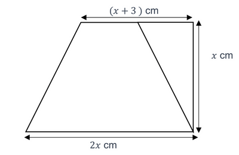
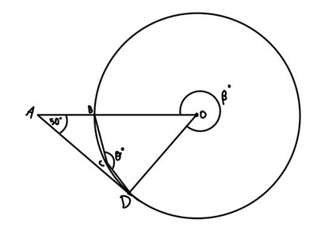
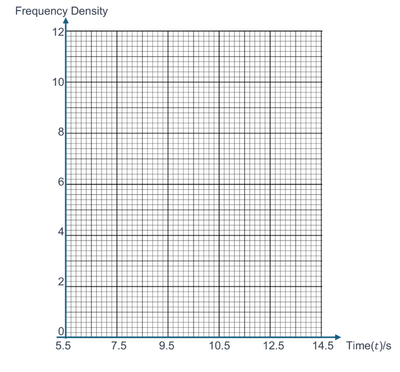
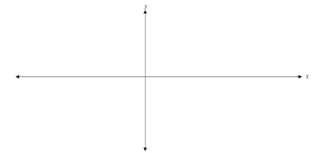
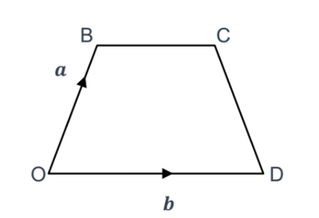
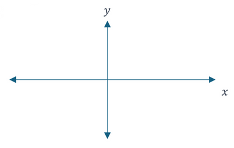

## Paper 26

**Q1.** State the exact value of $\sin30^\circ$. $_{\text{[1 mark]}}$

$\hspace{1cm}$

**Q2.** Write down 8,100,000 in standard form. $_{\text{[1 mark]}}$

$\hspace{1cm}$

**Q3.** State if the numbers below are rational or irrational.

*(a)* $\sqrt{3}_{\text{[1 mark]}}$

*(b)* $\frac{1}{3}_{\text{[1 mark]}}$

$\hspace{1cm}$

**Q4.** Work out $\sqrt[3]{125} \div 2^2$, giving your final answer as a decimal.  $_{\text{[2 marks]}}$

$\hspace{1cm}$

**Q5.** Expand 7(5 + 2$t$). $_{\text{[1 mark]}}$

$\hspace{1cm}$

**Q6.** Work out $4\frac{1}{5} - \frac{7}{10}_{\text{[3 marks]}}$

$\hspace{1cm}$

**Q7.**

In terms of $x$, work out the area of the shape above.

Simplify your answer.  $_{\text{[4 marks]}}$

$\hspace{1cm}$

**Q8.** The number of passengers on a train increases from 80 to 100.

Calculate the percentage increase.  $_{\text{[2 marks]}}$

$\hspace{1cm}$

**Q9.** The probability that a blue colored candy is received from a candy bag is 0.45.

The candy bag consists of 20 candies.

Work out the expected number of blue candies in the candy bag.  $_{\text{[2 marks]}}$

$\hspace{1cm}$

**Q10**

Points $B$, $C$ and $D$ lie on the circumference of the circle with center $O$.

$ABO$ is a straight line and $AD$ is tangent at $D$ to the circle.
Angle $DAO$ is 50°.

*(a)* Work out the value of $\beta$. $_{\text{[4 marks]}}$

*(b)* Work out the value of $\theta$, giving a geometrical reason to support your answer.

$\theta$ = ....................................................................................................................................

Reason: ..........................................................................................................................................  $_{\text{[2 marks]}}$

$\hspace{1cm}$

**Q11.** A juice bar has three types of juice: apple juice, orange juice, and grape juice.

The ratio of the amount of apple juice to orange juice is 2:3.

The ratio of the amount of orange juice to grape juice is 3:4.

If there are 48 liters of grape juice, work out how many liters of apple juice are there. $_{\text{[4 marks]}}$

$\hspace{1cm}$

**Q12.** Work out the surface area of the cube with volume 64 cm$^3$. $_{\text{[4 marks]}}$

$\hspace{1cm}$

**Q13.** *(a)* Show that $(2x + 3) + \frac{27}{(x - 3)}$ simplifies to $x^2 + 6x = 0$. $_{\text{[4 marks]}}$

*(b)* By factorization, solve the equation $x^2 + 6x = 0$. $_{\text{[3 marks]}}$

*(c)* The line $y = x − 6$ intersects the curve $y= 2x + 3 +\frac{27}{(x - 3)}$ at points $A$ and $B$.

Hence, or otherwise, work out the coordinates of points $A$ and $B$. $_{\text{[3 marks]}}$

$\hspace{1cm}$

**Q14.** The table below shows information about the times, $t$s, for a number of students to run 40 m.

#|
||

Time ($t$ s)

|

$5.5 < t \le 6.5$

|

$6.5 < t \le 9.5$

|

$9.5 < t \le 10.5$

|

$10.5 < t \le 13.5$

||
||

Frequency

|

12

|

30

|

4

|

4

||
|#

*(a)* *(i)* Estimate the mean time it takes for students to run 40 meters. $_{\text{[4 marks]}}$

*(ii)* Hence, calculate the mean speed of a student in centimeters per second. $_{\text{[3 marks]}}$

*(b)* On the grid below, draw a histogram to show the information in the table. $_{\text{[4 marks]}}$

$\hspace{1cm}$

**Q15.** (a) Factorise $-x^2 + 4x -3._{\text{[2 marks]}}$

*(b)* *(i)* By completing the square, work out the coordinates of the stationary point of the curve $y = -x^2 + 4x -3._{\text{[3 marks]}}$

*(ii)* Justify the nature of the stationary point of the curve $y = -x^2 + 4x -3._{\text{[3 marks]}}$

*(c)* *(i)* Roughly sketch the curve $y = -x^2 + 4x -3._{\text{[2 marks]}}$

*(ii)* On your sketch, label the coordinates of:
-  $x$ intercepts
-  $y$ intercept
- stationary point.$_{\text{[3 marks]}}$
 
$\hspace{1cm}$

**Q16.** *(a)* $ a=\begin{pmatrix} 2 \\ 4  \end{pmatrix} \quad b=\begin{pmatrix} 3 \\ 4  \end{pmatrix} \quad c=\begin{pmatrix} 6 \\ 12  \end{pmatrix}$

*(i)* Work out $|c − a|$ in the form $k\sqrt{n}$, where $k$ is an even integer and $n$ is an odd integer.

*(ii)* $xa + yb + c$

Write down two simultaneous equations and solve them to find the value of $x$ and the value of $y$.

Show all your working.  $_{\text{[5 marks]}}$

$\hspace{1cm}$

*(b)*

The diagram shows a trapezium $OBCD$.

$O$ is the origin, $\vec{OB} = a$ and $\vec{OD} = b$.

$|\vec{BC}| = \frac{3}{4}|\vec{OB}|$

*(i)* Find $|\vec{CD}|$ in terms of $a$ and $b$, in its simplest form.$_{\text{[2 marks]}}$

*(ii)* When $CD$ and $OB$ are extended, they intersect at $E$.

Find the position vector of $E$. $_{\text{[2 marks]}}$

$\hspace{1cm}$

**Q17.** *(a)* Sketch the graph of $y = 1^x._{\text{[1 mark]}}$

*(b)* Sketch the graph of $y = 7x^\circ._{\text{[1 mark]}}$

$\hspace{1cm}$

**Q18.** A cylindrical tank has a radius of 2 meters and a height of 20 meters. It is filled with water to a height of 5 meters. A solid metal sphere with a radius of 3 meters is then completely submerged in the water.

Calculate the change in height of the water level as the sphere is completely submerged.  $_{\text{[5 marks]}}$

$\hspace{1cm}$

**Q19.** Work out the recurring number $0.4\dot{3}$ as a fraction. $_{\text{[2 marks]}}$

$\hspace{1cm}$

**Q20.** By writing each number correct to 1 sf, estimate the value of $\frac{58.5 x 2.49}{3.501}._{\text{[2 marks]}}$

$\hspace{1cm}$

**Q21.** Simplify $\frac{3\sqrt{x}}{4y^2} \times \frac{4yx}{sqrt[4]{x}}._{\text{[4 marks]}}$

$\hspace{1cm}$

**Q22.** A multiple choice test consists of 40 questions has negative marking for incorrect.

Each correct answer gains 2 marks, each incorrect answer loses 1 mark and a blank answer receives 0 marks.

A student answers 35 questions, out of which, he gets 25 of them correct.
Work out the percentage mark that the student scores.  $_{\text{[2 marks]}}$

$\hspace{1cm}$

**Q23.** $E =\frac{1}{2}kx^2$ is a formula used to find elastic potential energy of a spring.

Given that $k$ = 10 and $x$ = 10, find the value of $E$.  $_{\text{[2 marks]}}$

$\hspace{1cm}$

**Q24.** Thor changes 1250 Indian rupees into New Zealand dollars when the exchange rate is 1 New Zealand dollar = 50 Indian rupees.

Work out how many New Zealand dollars he receives, giving your answer correct to 2 decimal places.  $_{\text{[2 marks]}}$