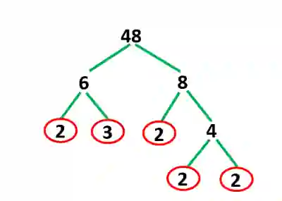
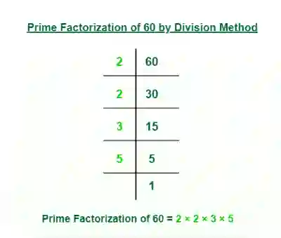
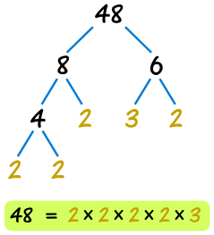

## Prime Factors, LCM, and HCF

### **Prime Factorisation**

* Writing a number as a product of its prime factors

* For eg, 60 = 2² x 3 x 5

* **Methods:**

  * **Factor Tree Method** - break the number down step-by-step into primes

    

  * **Division Method** - keep dividing by the smallest prime until you reach 1

    

### **Highest Common Factor and Lowest Common Multiple**

- **HCF:** Product of common prime factors

- **LCM:** Product of all prime factors in the Venn Diagram

  