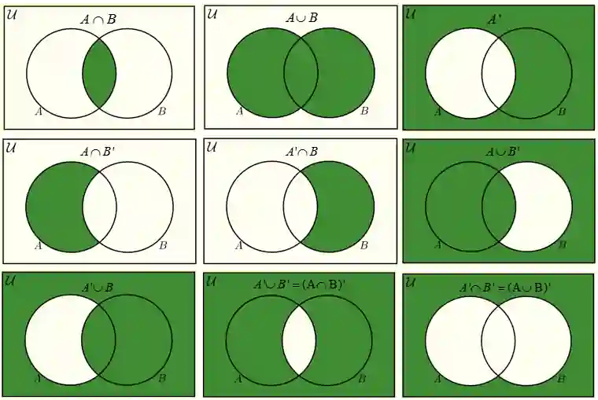

## Sets

### Definition of Sets

* A set is a collection of elements. e.g.

  * $A$ = $\{𝑥:𝑥 \text{ is a natural number}\}$        [A is the set of all natural numbers]
  * $B$ = $\{(x,y): y=mx+c\}$
  * $C$ = $\{x: a\le x\le b\}$
  * $D$ = $\{a,b,c,…\}$

### Set Notation

* $\in$ = …is an element of…

* $\notin$ = …is not an element of…

* $A'$ = complement of set A

  * The complement of Set A is the set of all the elements that are inside the universal set but not in Set A

* $\emptyset$ = empty set (e.g. A = {})

* $\xi$ = Universal set

  * A set that contains all elements of all other sets

* $\cap$ = Union

  * All elements in A and B

* $\cup$ = Intersection

  * Common elements in A and B

* $\subseteq$ = Subset

  * All elements of A are in B, and A can be = B

* $\subset$ = Proper Subset

  * All elements of A are in B, and A ≠ B

* ⊈ = Not a Subset

  * A has some element outside of B.

* n(A) - the number of elements in a set A

### Equal Sets

* Two sets that contain the same elements, regardless of the order in which the elements appear

### Set Representations

