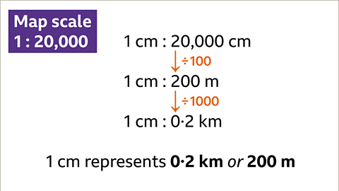

## Ratio & Proportion

### Ratio

- Used to describe a fraction

  - e.g. 3:1

### Foreign Exchange

* Money changed from one currency to another
  using proportion
- E.g., Convert $22.50 to Dinars

  
$1 : 0.30KD

  
$22.50 : 6.75KD

### Map Scales

* Using proportion to work out map scales

- 1km = 1000m

- 1m = 100cm

- 1cm = 10mm

### Direct Variation

- $y$ is proportional to $x$

  $y \propto x$

  $y = kx$

### Inverse Variation

- $y$ is inversely proportional to $x$

  $y \propto \frac{1}{x}$

  $y = \frac{k}{x}$