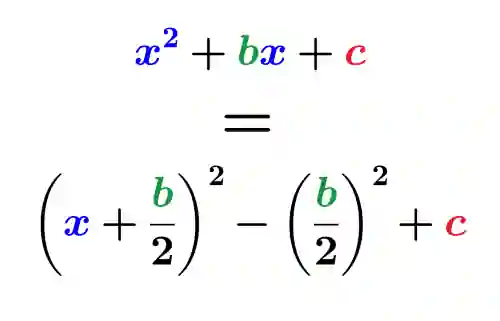

# Algebra & Graphs

## Algebraic Manipulation

### Algebraic Simplification

* To simplify, combine terms that have the same variable and exponent.

$\text{Q1. }2a + 3b + 5a - 9b$

**Step 1:** Group like terms as they have the same variable raised to the same power

* $(2a+5a)+(3b-9b)$

**Step 2:** Simplify each group and write the simplified expression

* $\boxed{7a - 6b}$

### Algebraic Expansion

* When expanding products, multiply the values outside the brackets by the values inside the brackets.

$\text{Q1. }3x(2x - 4y)$

**Step 1:** Apply Distributive Law

* $a(b+c) = ab + ac$
* $3x(2x)+3x(-4y)$

**Step 2:** Multiply each term inside by 3x

* $(3x)(2x) = 6x^2$

* $(3x)(-4y) = -12xy$

**Step 3:** Write the result

* $\boxed{6x^{2}-12xy}$

$\text{Q2. } (3x-5)(4x+8)$\
**Step 1:** Distribute $3x$ across the second bracket

* $3x\times 4x = 12x^2$

* $3x\times 8 = 24x$

**Step 2:** Distribute $-5$ across the second bracket

* $-5\times 4x = -20x$

* $-5\times 8 = -40$

**Step 3:** Combine all terms

* $12x^2 + 24x - 20x -40$

**Step 4:** Simplify like terms

* $24x-20x = 4x$

**Step 5:** Write the results

* $\boxed{12x^{2}+4x-40}$

---

### **Algebraic Factorization**

$\text{Q1. Factorize } 12x^2 + 18x$

**Step 1:** Find the HCF of the terms

* HCF of coefficients 12 and 18 is 6.

* HCF of variables $x^2$ and $x$ is $x$.

* Overall HCF is $6x$

**Step 2:** Factor out the HCF

* Write the HCF outside a bracket and divide each term by $6x$.

* $12x^{2}\div 6x = 2x$, $18x\div 6x = 3$

**Step 3:** Write the results

* $\boxed{6x(2x+3)}$

### **Completing the Square**

