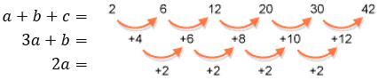
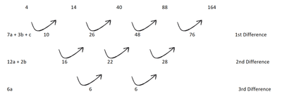

## Sequences

### Linear Sequences

* A linear sequence is a list of numbers where the difference between consecutive terms is constant.
* $\text{nth term formula: } T_n =  a + (n-1)d$
  * $a$ = first term

  * $n$ = term number

  * $d$ = common difference
* $\text{Common Difference: } d = T_{n+1} - T_{n}$

### Quadratic Sequences

* A quadratic sequence has a constant second difference.

* General Form: $T_n = an^{2} + bn + c$

  * $2a$ = 2nd Difference ($d_2$)

  * $3a+b$ = 1st Difference ($d_1$)

  * $c$ = $T_1 - a - b$

* nth term formula: $T_n = a + (n-1)d_{1} + \frac{d_2 }{2} (n-1) (n-2) $

  * $a$ = First Term

  * $d_1$ = First Difference

  * $d_2$ = Second Difference

* Work out the values and then place them into a formula to work out the nth term formula

---

### Cubic Sequences

* A cubic sequence has a constant third difference.
* General Form: $T_n = an^{3} + bn^{2} + cn + d$
  * $7a+3b+c$ = 1st Difference ($d_1$)

  * $12a+2b$ = 2nd Difference ($d_2)

  * $6a$ = 3rd Difference ($d_3$)
* Find the differences until the third difference is constant.
* Use formulas or simultaneous equations to solve for $a$, $b$, $c$, $d$.

* nth term formula : $T_n = a + (n-1)d_1 + \frac{d_2}{2} ({2}(n-1)) (n-2) + \frac{d_3}{6} ({6}(n-1))(n-2)(n-3)$

  * $d_1$ = 1st Difference

  * $d_2$ = 2nd Difference

  * $d_3$ = 3rd Difference

---

### Exponential Sequence (Geometric Progression)

* In an exponential sequence, each term is multiplied by a constant ratio $r$.

* nth term formula = $T_n = a r^{n-1}$

  * $a$ = First Term

  * $r$ = $\frac{T_n }{T_{n-1} }$ (Common Ratio)

  * $n$ = Term Number