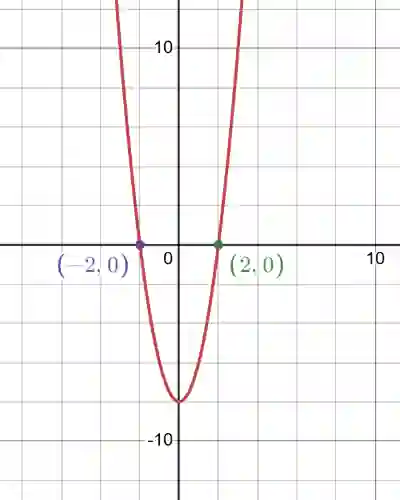

## Quadratic Equations

### **General Form**

$ax^{2} + bx + c = 0$

where $a$ ≠ 0

### **Solving a Quadratic Equation**

1. **Factorization**

* Factorisation means rewriting the quadratic expression into two linear brackets. We look for two numbers that multiply to $a \times c$ and add to b, then solve using the zero-product rule.

* **Worked Example**

  $\text{Q1. Solve } x^{2}-x-6=0$

  **Step 1:** Identify the coefficients: $a=1$, $b=-1$, $c=-6$

  **Step 2:** Multiply $a \times c = 1 \times (-6) = -6$

  **Step 3:** Find two numbers that multiply to $-6$ and add to $-1$ $\rightarrow$ $-3$ and $2$

  **Step 4:** Factorize: $(x-3)(x+2)=0$

  **Step 5:** Solve each bracket: $x=3,-2$

  $\text{Q2. Solve } 2x^{2} + 7x + 3=0$

  **Step 1:** Identify the coefficients: $a=2$, $b=7$, $c=3$

  **Step 2:** Multiply $a \times c = 2 \times 3 = 6$

  **Step 3:** Find the two terms that multiply to 6 and add to 7 $\rightarrow$ $6$ and $1$.

  **Step 4:** Rewrite: $2x^{2}+6x+x+3$

  **Step 5:** Group Items: $2x(x+3)+1(x+3)$

  **Step 6:** Factorize: $(2x+1)(x+3)=0$

  **Step 7:** Solve: $x= \frac{-1}{2} , 3$

---

2. **Quadratic Formula**

$$
x = \frac{- b \pm \sqrt{b^{2} - 4ac}}{2a}
$$

* When the question says, “Give your answer to two decimal places,” use the formula!
* Derivation of the Quadratic Formula is the same as saying “Make
  $x$ the subject in $ax^{2} + bx + c = 0$”

$$
ax^{2} + bx + c = 0
$$

$$
a\left( x^{2} + \frac{b}{a}x \right) + c = 0
$$

$$
a\left( \left( x + \frac{b}{2a} \right)^{2} - \frac{b^{2}}{4a^{2}} \right) + c = 0 \text{  (Completing the Square)}
$$

$$
a\left( x + \frac{b}{2a} \right)^{2} - \frac{b^{2}}{4a} + c = 0
$$

$$
a\left( x + \frac{b}{2a} \right)^{2} = \frac{b^{2} - 4ac}{4a}
$$

$$
\left( x + \frac{b}{2a} \right)^{2} = \frac{b^{2} - 4ac}{4a^{2}}
$$

$$
x + \frac{b}{2a} = \pm \sqrt{\frac{b^{2} - 4ac}{4a^{2}}}
$$

$$
x + \frac{b}{2a} = \frac{\pm \sqrt{b^{2} - 4ac}}{\sqrt{4a^{2}}}
$$

$$
x + \frac{b}{2a} = \frac{\pm \sqrt{b^{2} - 4\text{ac}}}{2a}
$$

$$
x = \frac{- b \pm \sqrt{b^{2} - 4\text{ac}}}{2a}
$$

* **Worked Example**

  $\text{Q1. }x^{2} - x - 6 = 0$

  **Step 1:** Identify coefficients

  $a = 1$, $b = - 1$, $c = - 6$

  **Step 2:** Substitute in Formula

  $x = \frac{- \left( - 1 \right) \pm \sqrt{\left( - 1 \right)^{2} - 4\left( 1 \right)\left( - 6 \right)}}{2\left( 1 \right)}$

  **Step 3:** Simplify

  $x = \frac{1 \pm \sqrt{1+24}}{2} = \frac{1 \pm \sqrt{25}}{2}$

  **Step 4:** Solve

  $x = \frac{1+5}{2} = 3 \text{ or } x = \frac{1-5}{2} = -2$

---

3. **Completing the Square**

* Completing the square is a method used to rewrite a quadratic expression of the form $ax^2+bx+c$  into the form $a(x+p)^2+q$, which is useful for solving equations and finding the vertex of a parabola.

* If an equation is in completing the square form, $a(x+h)^2+k$, the coordinates of the turning point (vertex) of the parabola are $(-h,k)$

* **Worked Example**

  $\text{Q1. Solve } x^{2} + 6x + 5 = 0$

  **Step 1:** Identify the coefficients

  $a=1$, $b=6$, $c=5$

  **Step 2:** Take the half of the coefficient of $x$ and square it

  Coefficient of $x$ = $6$

  Half of it = $\frac{6}{2}=3$

  Square it = $3^{2}=9$

  **Step 3:** Add and subtract this square inside the equation

  $x^{2}+6x+9-9+5$

  **Step 4:** Write as a perfect square

  $(x^2 +6x+9) = (x+3)^{2}$

  **Step 5:** Solve the equation

  $(x+3)^{2}-4=0$

  $(x+3)^{2}=4$

  $x+3= \pm 2$

  **Step 6:** Find the roots

  If $x+3=2$, then $x=-1$

  If $x+3=-2$, then $x=-5$

  **Step 7:** Write the final answer

  $\boxed{x=-1,-5}$

---

4. ### Graphing Method

- Plot the graph of $y=ax^2+bx+c$

- The points where the graph cuts the x-axis ($y=0$) are the solutions (roots) of the equation

  