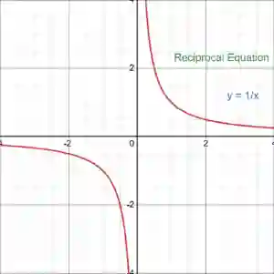
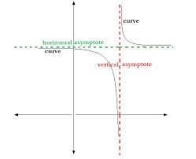
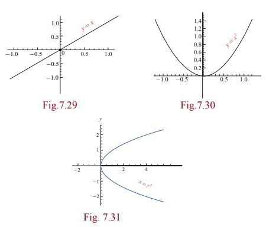

## Rectangular Graphs

### Standardized Form

* Basic Form: $y = \frac{a}{x}$
* Transformed Form: $y = \frac{a}{x-h} +k$
  * where $(h,k)$ shifts the hyperbola.

### Position of Graph

* If $a >0$: Graph lies in the **1st** and **3rd** quadrants.

* If $a<0$: Graph lies in the **2nd** and **4th** quadrants

### Asymptotes 

* Asymptotes are lines that the curve approaches but never touches.

* For $y = \frac{a}{x-h} + k$:

  * **Vertical Asymptote:** $x=h$

  * **Horizontal Asymptote:** $y=k$

* For Example: For $y= \frac{1}{x}, asymptotes are $x=0$ and $y=0$

### Symmetry

* Hyperbolas are symmetrical about their asymptotes

Line of Symmetry for:

Fig 7.29 : y = x

Fig 7.30 : x = 0

Fig 7.31 : y = 0