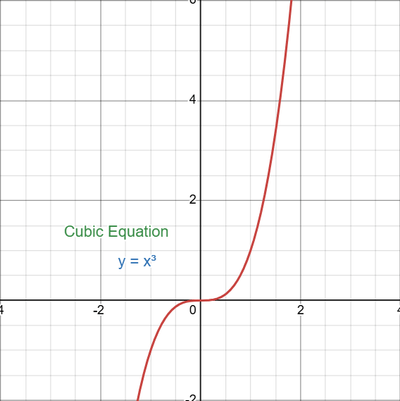

## Cubic Equation

### Standard Form

* $y = ax^{3} + bx^{2} + cx + d$

### Key Properties

* The highest power of $x$ is 3.
* The graph can have:
  * Up to 2 turning points (maxima/minima).

  * One point of inflection (where gradient = 0, but curve doesn’t change direction)
* The shape depends on the sign of $a$:
  * When a > 0, a min-max curve is formed

  * When a < 0 a max-min curve is formed

### Turning Points

* Turning points are points on a graph where the gradient (slope) changes sign — the graph changes direction from increasing to decreasing, or vice versa

* Found by differentiating:

  $$
  \frac{dy}{dx} = 3ax^{2} + 2bx + c
  $$

  and solving $\frac{dy}{dx} = 0$.

