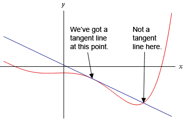

## Gradient of a Curve

* For a **straight line**, the gradient is **constant** everywhere.
* For a **curve**, the gradient **changes** at different points on the graph.

### Method: Finding the Gradient at a Point (By Tangents)

1. Draw the graph

2. Choose the point where you want to find the gradient

3. Draw a tangent to the curve at that point, making sure it just touches the curve at that point (Use a ruler)

4. Find the gradient of the tangent

   $$
   \text{Gradient} = \frac{\text{Change in }y}{\text{Change in }x}
   $$

