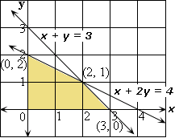
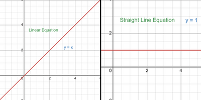

## Linear Programming

### Types of Inequalities in a Graph

* **Strict Inequalities** ($<$, $>$) $\rightarrow$ Use a broken/dashed line

* **Non-strict Inequalities** ($\leq$, $\geq$) $\rightarrow$ Use a solid line

### Steps to Solve a Linear Programming Problem

* Write inequalities in the form $y = mx + c$
* Draw straight-line graphs of each inequality
  * Use solid or broken lines depending on the inequality type
* Test a point on either side of the line to see which side satisfies the inequality
* Shade the required region for each inequality
  * The common area is called the feasible region

