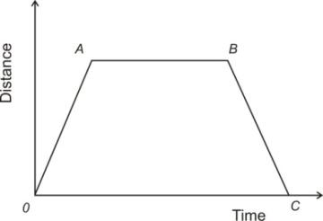
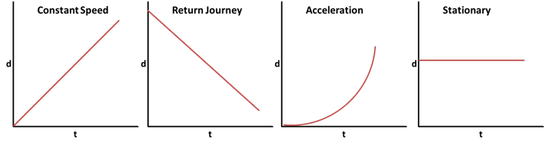

## Distance-Time Graphs

- $\text{Speed} = \frac{\text{Distance}}{\text{Time}}$

- $\text{Average Speed} = \frac{\text{Total Distance Travelled}}{\text{Total Time Taken}}$

  

- **From O to A**: Uniform speed

  - Lines with a positive gradient represent objects moving away from the  starting point

- **From A to B**: Stationery (speed = 0)

  - Lines with a gradient of 0 represent the object to be at rest

- **From B to C**: Uniform speed (return journey)

  - Lines with a negative gradient represent objects moving towards the starting point

- $\text{Gradient of Distance - Time Graphs} =  \text{Speed}$