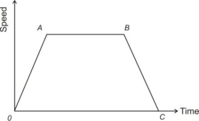
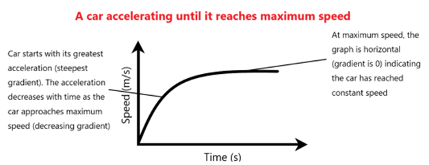
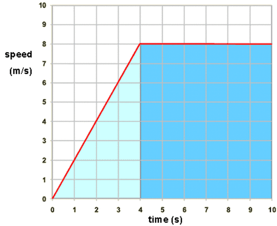

## Speed-Time Graphs

* **From O to A:** Uniform increase in speed
  * Lines with a positive gradient represent constant acceleration
* **From A to B:** Constant speed (acceleration = 0)
  * Lines with 0 gradient represent constant speed
* **From B to C:** Uniform deceleration/retardation
  * Lines with a negative gradient represent deceleration

* Graph 1: A Straight Increasing Non-Horizontal Line indicates a constant acceleration where a > 0
* Graph 2:  Straight Decreasing Non-Horizontal Line indicates a constant acceleration where a < 0 or deceleration
* Graph 3: Horizontal Line indicates moving at constant speed. a = 0
* Gradient of Speed - Time Graph = Acceleration
* If the acceleration is negative, it is called deceleration or
  retardation. (The moving body is slowing down.)
* $\text{Acceleration} = \frac{\text{Change in Velocity}}{\text{Time}} = \frac{v - u}{t}$

### How to find Distance from Speed - Time Graph

Distance = Area under Speed-Time Graph

* $\frac{1}{2} \times 4 \times 8 = 16$

* $6 \times 8 = 48$

* 48 + 16 = 64 meters