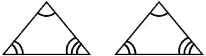
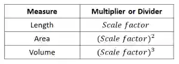
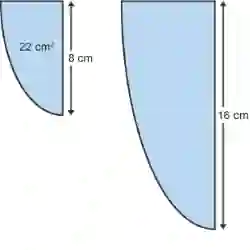
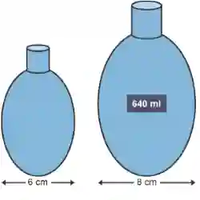

# Geometry

## Similarity

* If two objects are similar, that means that they are the exact same shape but different in size
* All corresponding lengths must be in the same ratio
* **AAA (Angle – Angle – Angle) Rule:** All the corresponding angles
  of the triangles must be equal.

### **Area and Volume of Similar Shapes**

* Similar shapes are enlargements of each other using a scale factor

  

---

**Worked Examples**

* **Example 1:**

  

  $\text{Small to Big} = \frac{\text{Big}}{\text{Small}} = \frac{16}{8} = 2$

  $\text{Scale Factor} = 2$

  $\text{Area of Bigger Shape} = 2^2 \times 22 = 88$

  **Example 2:**

  

  $\text{Big to Small} = \frac{\text{Small}}{\text{Big}} = \frac{6}{8} = \frac{3}{4}$

  $\text{Scale Factor} = \frac{3}{4}$

  $\text{Volume of Smaller Shape} = \left(\frac{3}{4}\right)^3 \times 640 = 270\ \text{ml (to the nearest ml)}$

* **Direct Formula to Use**

$\left(\dfrac{A_1}{A_2}\right)=\left(\dfrac{L_1}{L_2}\right)^2 \quad\text{and}\quad
\left(\dfrac{V_1}{V_2}\right)=\left(\dfrac{L_1}{L_2}\right)^3$