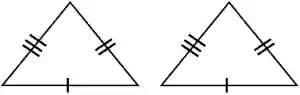
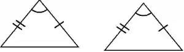
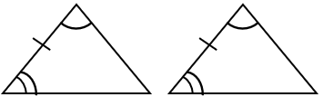

## Congruence

* If two objects are congruent, that means that they are identical. Same shape and same size

* **SSS (Side – Side – Side) Rule:** All three sides of the
  triangles must be equal

  

* **RHS (Right angle – Hypotenuse – Side) rule :**

* There must be two right-angled triangles

* **SAS (Side – Angle – Side) rule:**

  

* **ASA (Angle – Side – Angle) rule:** The sides adjacent to the equal angle
  angles must be of the same length.

**Angle Notation:**

* Angles are represented with this symbol - $\angle$

* Its written like $\angle {A}{B}{C}$ with the middle letter (B) being the vertex