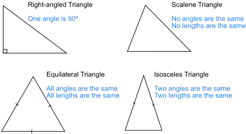

## Triangles

### **Equilateral Triangle**

* All **three sides are equal** in length.

* All **three angles are equal** (each **60°**).

* Perfectly symmetrical.

### **Isosceles Triangle**

* Has **two equal sides**.

* The angles **opposite the equal sides** are also **equal**.

* Has **one line of symmetry**.

* Useful for angle-finding questions using the rule

* Base angles in an isosceles triangle are equal

### **Scalene Triangle**

* **No sides are equal**.

* **No angles are equal**.

* Irregular shape with **no symmetry**.

### **Right-Angled Triangle**

* Contains **one right angle (90°)**.

* The side opposite the right angle is the **hypotenuse** (the longest side).

* Used for:

  * **Pythagoras’ theorem**

  * **Trigonometry (sin, cos, tan)**