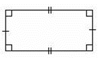
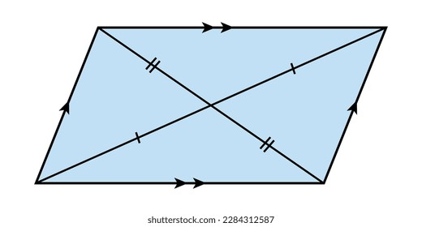
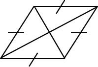
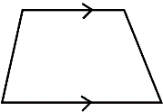
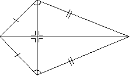
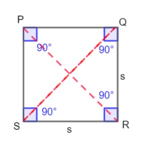

## Quadrilaterals

### Rectangle

* Opposite sides are parallel and equal

* All internal angles are 90°

* Diagonals bisect each other

* Diagonals are equal in length

### Parallelogram

* Opposite sides are parallel and equal

* Opposite angles are equal

* Diagonals are not necessarily equal

* No right angles unless it's a rectangle

* diagonals bisect each other

### Rhombus

* A parallelogram with all sides equal

* Opposite angles are equal

* Diagonals bisect each other at 90°, and they bisect opposite angles

### Trapezium

* One pair of sides is parallel

### Kite

* Two pairs of adjacent sides are equal

* Diagonals are perpendicular to each other

* One pair of opposite angles is equal (those between the unequal sides)

* One diagonal is bisected (the one joining equal angles

### Square

* Four equal sides and four right angles

* Opposite sides are parallel

* Diagonals that are equal in length and bisect each other at right angles

* Diagonals bisect opposite angles