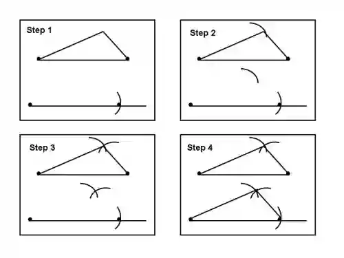
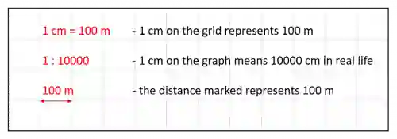

## Construction

- **Constructing triangles:**

Step 1 : Draw the base line using a ruler

Step 2 : Using a compass, measure the desired length on a ruler and draw an arc

Step 3 : Similarly use the compass to measure the 2nd side and draw an arc

Step 4 : Connect the ends of the baseline to the point where the arc intersect.

**Scale Drawings :**

* Always make sure to convert to correct units when drawing diagrams