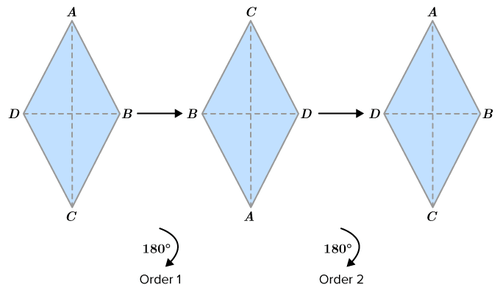
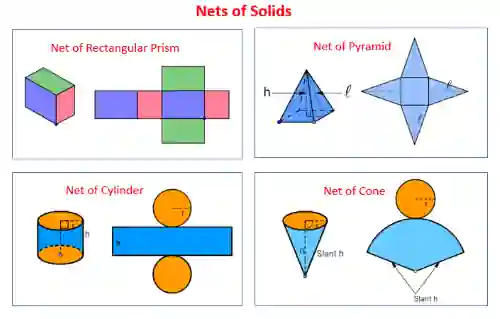
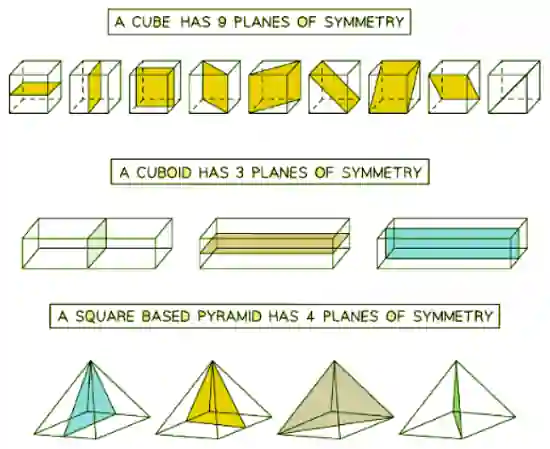

## Symmetry and Nets

- **Line of Symmetry**: Divides a two-dimensional shape into two congruent (identical) shapes

- **Plane of Symmetry**: Divides a three-dimensional shape into two congruent solid shapes

- **Rotational Symmetry:** The number of times a shape looks the same during a 360° rotation about its center

  

|**Shape**|**Number of Lines of Symmetry**|**Rotational Symmetry Order**|
|:---|:---|:---|
|**Square**|4|4|
|**Rectangle**|2|2|
|**Parallelogram**|0 (General parallelogram have 0 line of symmetry)|2|
|**Rhombus**|2|2|
|**Trapezium**|0|1|
|**Kite**|1|1|
|**Equilateral triangle**|3|3|
|**Regular hexagon**|6|6|

---

## **Nets**

* This is a 2D shape that can be folded to form a 3D shape

* This is usually used to help find areas of 3D shapes

## **Symmetry of 3D shapes**

