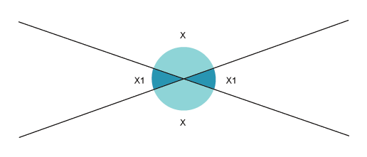
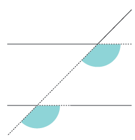
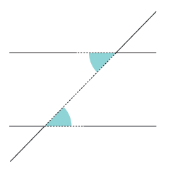
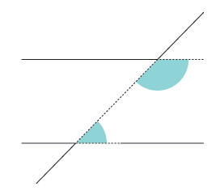
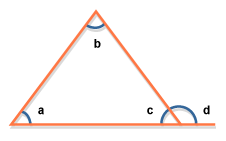

## Angles

* Sum of angles at a point $= 360{^\circ}$
* Angles on a straight line $= \ 180{^\circ}$
* Sum of angles in a triangle $= 180{^\circ}$
* For regular polygon
  * Each Exterior Angle of a regular polygon $= \frac{360{^\circ}}{n}$
  * Each Interior Angle of a regular polygon  $= 180{^\circ} - \frac{360{^\circ}}{n}$ or $\frac{(n - 2) \times 180}{n}$
* Vertically opposite angles are equal

* Corresponding angles are equal

* Alternate angles are equal

* Co-interior angles add up to 180°

* Exterior angle=sum of interior opposite $\angle {a} + \angle {b}$

