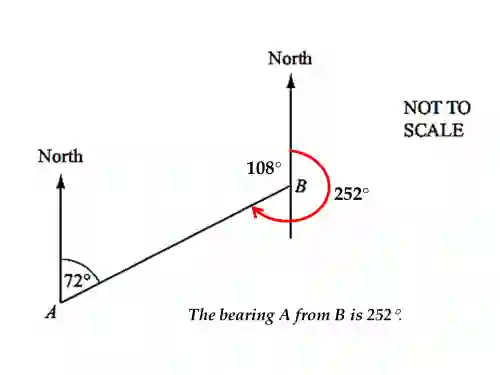

## Bearings

* **The bearing of a point B from another point A is:**
  * An angle measured from the north at A.
  * In a clockwise direction.
  * Written as three-figure number (i.e. from 000° to 360°)

**How to Calculate Bearings (from the example above)**

* ### **Step 1 — Identify the starting point**

  * Bearing of **A from B**” means:

    * Start at **B**

    * Look **towards A**

* ### **Step 2 — Draw or identify the North line**

  * At point **B**, draw a vertical line pointing up — this is **North**.

  * Bearings are always measured **from the North line**.

* ### **Step 3 — Bearings must be measured *clockwise***

  * This is the most important rule.

  * Always rotate **clockwise** from the North line until you reach the line pointing to the other point.

* ### **Step 4 — Look at the angle given in the diagram**

  * The diagram shows **108°**, but this angle is measured **anticlockwise** from the North line down to line BA.

  BUT bearings are **not measured anticlockwise** — only **clockwise**.

* ### **Step 5 — Use the full circle to find the clockwise angle**

  The full turn around a point is **360°**.

  Since the diagram gives the **anticlockwise** angle:

  $\text{Clockwise angle} = 360^\circ - 108^\circ = 252^\circ$

* **Final Answer = 252**