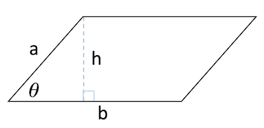
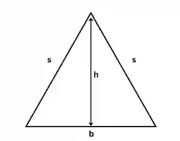
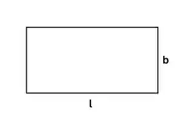
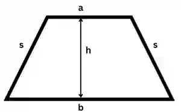
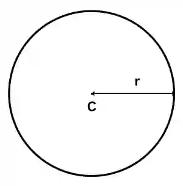
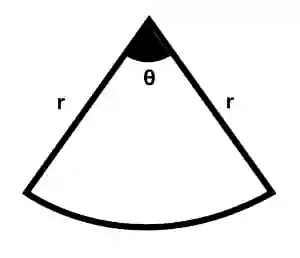
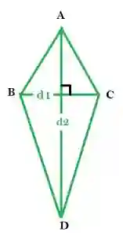

# Mensuration

## Area and Perimeter

### Parallelogram

* $\text{Area} = b \times h$ or $ab \sin(\theta)$

* $\text{Perimeter} = 2a + 2b$

### Triangle

* $\text{Area} = \frac{1}{2}b \times h$

* $\text{Perimeter} = b + 2s$

  * b = base , s = slant height

    

### Rectangle

* $\text{Area} = l \times b$

* $\text{Perimeter} = 2l + 2b$

  * l= length , b= breadth

    

### Trapezium

* $\text{Area} = \frac{1}{2}\left( a + b \right)h$

* $\text{Perimeter} = a + b + 2s$

  * s = slant height

    

### Circle

* $\text{Area} = \pi r^{2}$

* $\text{Circumference} = 2\pi r$

  

### Sector

* $\text{Area of Sector} = \frac{\theta}{360^\circ} \times \pi r^2$

* $\text{Arc Length} = \frac{\theta}{360} \times 2\pi r$

  

### Kite

* $\text{Area} = \frac{d1\times d2}{2}$

* $\text{Perimeter} = AB + BD + DC + CA$

