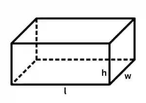
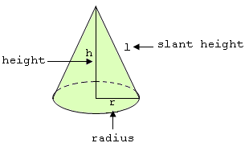
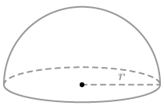
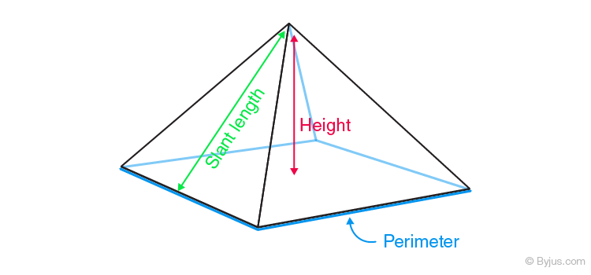
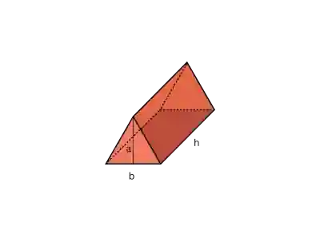

## Volume and Surface Area

### Cuboid

* $\text{Volume} = lwh$

* $\text{Surface Area} = 2(lw + wh + hl)$

  

### Cylinder

* $\text{Volume} = \pi r^{2}h$

* $\text{Curved Surface Area} = 2\pi rh$

* $\text{Total Surface Area} = 2\pi r^2 + 2\pi rh$

  

### Cone

* $\text{Volume} = \frac{1}{3}(\pi r^2h)$

* $\text{Curved Surface Area} = \pi r l$

* $\text{Total surface Area} = \pi r^2 + \pi r l$

* 

### Sphere

* $\text{Volume} = \frac{4}{3} \pi r^3$

* $\text{Surface Area} = 4 \pi r^2$

* 

### Hemisphere

* $\text{Volume} = \frac{2}{3} \pi r^3$

* $\text{Curved Surface Area} = 2\pi r^2$

* $\text{Surface Area} = 3 \pi r^2$

* 

### Pyramid

* $\text{Volume} = \frac{1}{3} b^2 h$

* $\text{Surface Area} = b^2 + 2bs$

  * b = base length

  * s= slant height

    

### Prism

$\text{Volume} = \tfrac{1}{2} b a h$

$\text{Curved Surface Area} = 2(b+h) \times a$

$\text{Total Surface Area} = \text{Curved Surface Area} + 2(b \times h)$

