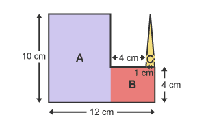
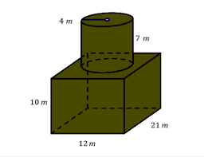

## Compound Shapes and Parts of Shapes

* How to find Area and Perimeters of Compound Shapes
* 2D Shapes

* 3D Shapes

Surface Area of Shape:

Step 1: Surface Area of Cuboid (without the top face)

$2(lh + wh) + lw$

$= 2(12 \times 10 + 21 \times 10) + (12 \times 21)$

$= 2(120 + 210) + 252$

$= 2(330) + 252 = 660 + 252 = 912 m^2$

Step 2: Remove circular hole (base of cylinder) from cuboid top

$\pi r^2 = \pi (4^2) = 16\pi m^2$

Adjusted cuboid surface area:

$912 - 16\pi$

Step 3: Curved Surface Area of Cylinder

$2 \pi r h = 2 \pi (4)(7) = 56\pi m^2$

Step 4: Add top circle of cylinder

$\pi r^2 = 16\pi m^2$

Step 5: Total Surface Area

$(912 - 16\pi) + 56\pi + 16\pi$

$= 912 + 56\pi m^2$