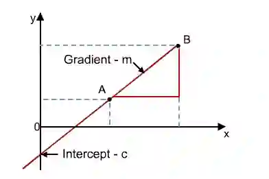
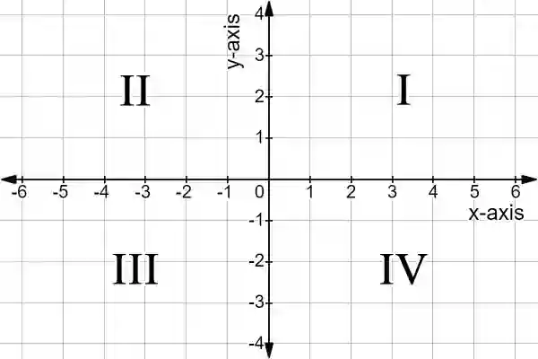

# Coordinate Geometry

## Graphs

### Gradient of a Straight Line

* Measure of the steepness of a straight line

* $Gradient = \frac{y_2 - y_1 }{x_2 - x_1 }$

### Equation of a Line

$$
Ax + By = C \quad \text{(General Equation of Line)}
$$

$$
\frac{x}{a} + \frac{y}{b} = 1 \quad \text{(Intercept Form)}
$$

$$
y = mx + c \quad \text{(Slope–Intercept Form)}
$$

* m = gradient

* c = y-intercept (the point the graph meets the y-axis)

  

### Midpoint of Graph

$$
Midpoint = \left( \frac{x_1 + x_2 }{2},\ \frac{y_1 + y_2}{2} \right)
$$

### Length between Two Points

$$
Distance = \sqrt{\left( x_2 - x_1 \right)^{2} + \left( y_2 - y_1 \right)^{2}}
$$

### Cartesian Coordinate System

* They are written in the (x,y) for

  

* **Quadrant 1:** (x,y)

* **Quadrant 2:** (-x,y)

* **Quadrant 3:** (-x,-y)

* **Quadrant 4:** (x,-y)