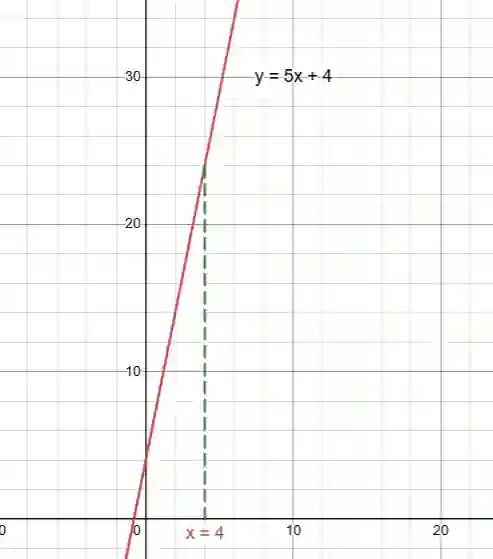
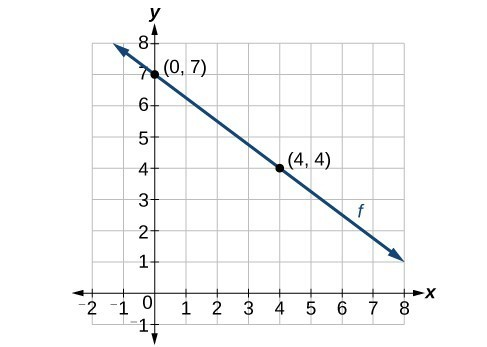

## Sketching Graphs

* **Step 1:** Plot the y-intercept (c) on the graph

* **Step 2:** Substitute x values (whole number values) into the equation and solve for y

* **Step 3:** The substituted x value is the x coordinate, and the solved y value is the y coordinate

* **Step 4:** Repeat for 4 more values and draw a straight line connecting these points

**How to Derive Equation of Line from Graph**

Find the gradient of $(0,7)$ and $(4,4)$:

$m = \frac{y_2 - y_1}{x_2 - x_1}$

$m = \frac{4 - 7}{4 - 0}$

$m = \frac{-3}{4}$

Equation of the line: $y = mx + c$

$y = -\tfrac{3}{4}x + c$

Substitute $(0,7)$:

$7 = -\tfrac{3}{4}(0) + c$

$7 = c$

Therefore, $y = -\tfrac{3}{4}x + 7$