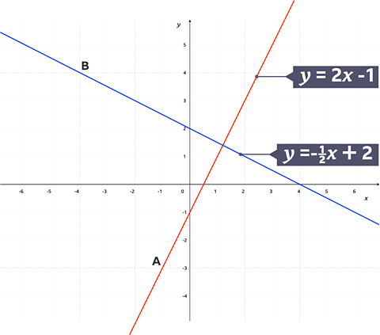

## **Parallel Lines and Perpendicular Bisectors**

### Parallel Lines

* Two lines are parallel if they share the same gradient but different y-intercepts

* For eg, $y = 3x + 5 \ \text{and} \ y = 3x + 12$

* Since the gradient of both lines is the same, and they have different y-intercepts, they are parallel to each other

### Perpendicular Lines

* Two Lines are perpendicular if they meet at 90º

* If Line A has a gradient m, then the gradient of Line B is -1/m

* For eg, $y = 2x+4 \ \text{and} \ y = \frac{-1}{2}x + 5$

* Two lines are perpendicular if the gradient of one line is the negative reciprocal of the other

### Perpendicular Bisectors

* Perpendicular Bisector is a line that intersects another line at its midpoint, and lies at an angle of 90º

  

* Example:

  Point A has coordinates $(7, -17)$

  Point B has coordinates $(19, -11)$

  We want the equation of the perpendicular bisector of $AB$.

  Step 1: Midpoint

  $M = \left( \frac{x_1 + x_2}{2}, \frac{y_1 + y_2}{2} \right)$

  $M = \left( \frac{7 + 19}{2}, \frac{-17 + (-11)}{2} \right)$

  $M = \left( \frac{26}{2}, \frac{-28}{2} \right)$

  $M = (13, -14)$

  Step 2: Gradient of $AB$

  $m_{AB} = \frac{y_2 - y_1}{x_2 - x_1}$

  $m_{AB} = \frac{-11 - (-17)}{19 - 7}$

  $m_{AB} = \frac{6}{12} = \tfrac{1}{2}$

  Step 3: Gradient of perpendicular bisector

  $m_{\perp} = -\frac{1}{m_{AB}} = -2$

  Step 4: Equation of perpendicular bisector

  $y - (-14) = -2(x - 13)$

  $y + 14 = -2x + 26$

  $y = -2x + 12$

  Therefore, the equation of the perpendicular bisector is:

  $\boxed{y = -2x + 12}$