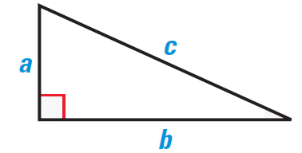
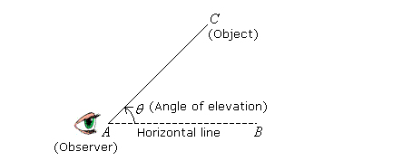
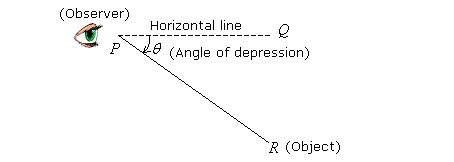

# **Trigonometry** 

## Pythagoras Theorem

* To find the Hypotenuse
  * $c^2 = a^{2} + b^{2}$

* To find one of the shorter sides
  * $a^{2} = c^{2} - b^{2}$
  * $b^{2} = c^{2} - a^{2}$

### Angle of Elevation

* Angle above the horizontal line

  

### Angle of Depression

* Angle below the horizontal line.

### Area of a Right-Angled Triangle

$$
\text{Area} = \frac{1}{2}bh
$$

* b = base

* h = height (a in the triangle above )