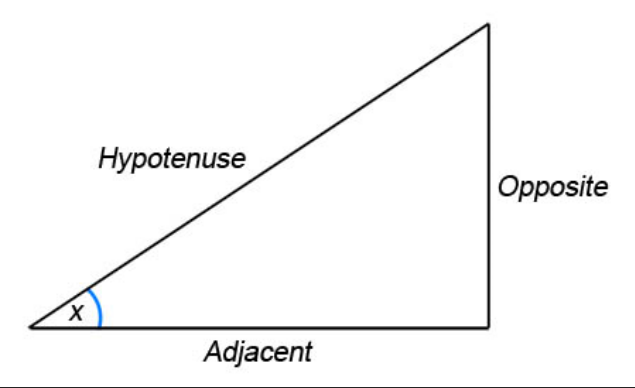

## Ratios

* The perpendicular distance from a point to a line is the shortest

**Right-Angled Triangles**

* $\sin{x} = \frac{\text{Opposite}}{\text{Hypotenuse}}$ → SOH
* $\cos{x} = \frac{\text{Adjacent}}{\text{Hypotenuse}}$ → CAH
* $\tan{x} = \frac{\text{Opposite}}{\text{Adjacent}}$ → TOA
  