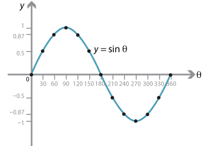
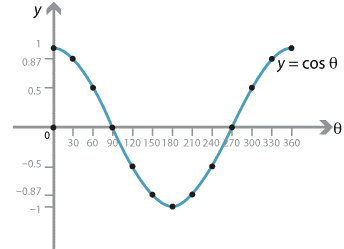
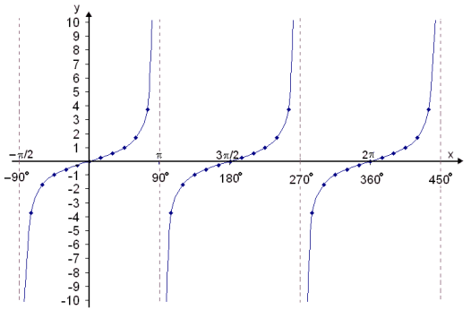

## Graphs of Simple Trigonometric Functions

* $\sin{(x)} = \sin{(180^{{^\circ}} - x)}$

* $\cos\left( x \right) = \cos{(360^{{^\circ}} - x)}$

* Sine and cosine shifted by 90°

* Sine has x-intercepts at multiples 180°, and cosine at (90° +
  multiples of 180°)

* $\tan{(x)} = \tan{(180^{{^\circ}} + x)}$

  

* Goes to infinity at 90°, 270°, 450°, …

* The tan graph has asymptotes at 90, 270, 450

* Has x-intercepts at multiples of 180°

