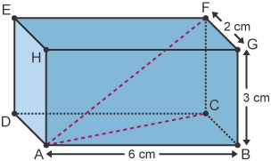

## Trigonometric Problems

### Trignometric Equations

* CAST diagram helps us to see in which quadrants the trig ratios are positive

$\text{Q.} 2 \cos(x) + 1 = 0 \text{ for } 0 \leq x \leq 360$

**Step 1:** Isolate $\cos(x)$

$2 \cos(x) + 1 =0$

$2 \cos(x) = -1$

$ \cos(x) = \frac{-1}{2}$

**Step 2:** Find base angle

$\cos( \alpha) = \frac{1}{2}$ (Ignore negative sign for base angle)

$\alpha = \cos^{-1} ( \frac{1}{2})$

$\alpha = 60$

**Step 3:** Determine the quadrants where the angle can lie

Use CAST diagram to identify quadrants

Since $\cos(x)$ was negative, we look for quadrants where cosine is negative

The solutions must lie in Quadrants II and III.

**Step 4:** Form angles in those quadrants using the base angles

**Quadrant II**

$x = 180^{ \circ} - \alpha$

$x = 180^{ \circ} - 60^{ \circ} = 120^{ \circ}$

**Quadrant III**

$x = 180^{ \circ} + \alpha$

$x = 180^{ \circ} + 60^{ \circ} = 240^{ \circ}$

**Final Answer:** $\boxed{ x = 120^\circ , 240^\circ}$

### Pythagoras Theorem in 3D Shapes

* $2^2 + 6^2 = AC^2$

* AC = 6.32

* $6.32^2 + 3^2 = AF^2$

* AF = 7 ( 1sf )