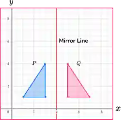

## Transformation

### Reflection (M)

- Image & object are the same size

- Image and Object are equidistant from the line of reflection

- Lines joining each point and its image are perpendicular to the mirror line

- Standard Cases of Reflection

  - Reflection in the x-axis

    Rule: $(x,y) \rightarrow (x,-y)$

  - Reflection in the y-axis

    Rule: $(x,y) \rightarrow (-x,y)$

  - Reflection in the line y = x

    Rule: $(x,y) \rightarrow (y,x)$

  - Reflection in the line y = -x

    Rule: $(x,y) \rightarrow (-y,-x)$

**Worked Example**

$\text{Q. Transform shape ABC by reflection in the line } y = x \text{. } A(2,1), B(4,1), C(4,3)$

**Step 1:** Apply the Rule

* Reflection in $y = x \rightarrow$ swap coordinates:

  $(x,y) \rightarrow (y,x)$

**Step 2:** Transform each point

* $A(2,1) \rightarrow A’ (1,2)$

* $B(4,1) \rightarrow B’ (1,4)$

* $C(4,3) \rightarrow C’ (3,4)$

**Step 3:** Plot the image

* Plot $A’, B’, C’$ and join them to form the reflected image.

**Step 4:** Check

* The image should be the same size

* Each point and its image should be the same distance from $y=x$

**How to Describe a Transformation (Reflection)**

1. Identify the line of reflection

* Look for a line that is exactly between points and their images

* Check equal distances:

  * eg: if A and A’ are both 3 units from the x-axis $\rightarrow$ line of reflection = x-axis.

2. State the transformation clearly

   Use the phrase:

   “Shape A is mapped onto Shape B by a reflection in the line ____”

### Rotation (R)

- The centre, angle, and direction of rotation are needed to describe a rotation

- A clockwise rotation is negative, and an anticlockwise rotation is positive

- Size and shape of rotation do not change

- Standard Cases of Rotation:

  - Rotation $90^{\circ}$ anticlockwise about the origin ($270^{\circ}$ clockwise)

    Rule: $(x,y) \rightarrow (-y,x)$

  - Rotation $90^{\circ}$ clockwise about the origin ($270^{\circ}$ anticlockwise)

    Rule: $(x,y) \rightarrow (y,-x)$

  - Rotation $180^{\circ} about the origin

    Rule: $(x,y) \rightarrow (-x,-y)$

**Worked Example**

$\text{Q. Rotate triangle ABC } 90^{\circ} \text{ anticlockwise about the origin. } A(2,1), B(4,1), C(4,3)$

**Step 1:** Use the rule

* For $(x,y) \rightarrow (-y,x)$

**Step 2:** Transform each point

* $A(2,1) \rightarrow A’ (-1,2)$

* $B(4,1) \rightarrow B’ (-1,4)$

* $C(4,3) \rightarrow C’ (-3,4)$

**Step 3:** Plot the image

* Plot A’,B’,C’ and join them to form the rotated image

**How to find the Centre of Rotation:**

- Join the corresponding vertices of the shapes

- Locate their midpoints

- Draw a perpendicular to both the midpoints

- The intersection is the centre of rotation

  

- Rotation of 180 degrees about the point (0,1)

### Translation (T)

* A translation slides a shape without rotating or reflecting it.

* To describe a translation, you must give the translation vector:

  $$
  \begin{pmatrix} a \\ b \end{pmatrix}
  $$

  - Right is $+x$, left is $-x$, up is $+y$, down is $-y$

- Size, shape, and orientation do not change under translation.

- Standard Form of Translation:

  - A translation by vector:

    $$
    \begin{pmatrix} a \\ b \end{pmatrix}
    $$

  - means:

    - Move a units horizontally

    - Move b units horizontally

  - Rule: $(x,y) \rightarrow (x+a, y+b)$

**Worked Example**

$\text{Q. Translate triangle ABC by vector } \begin{pmatrix} 5 \\ -2 \end{pmatrix} \text{ where } A(2,4), B(5,4), C(5,7)$

**Step 1:** Use the rule

* $(x,y) \rightarrow (x+5, y-2)$

* For the given vector, we move 5 units right and 2 units down

**Step 2:** Transform each point

* $A(2,4) \rightarrow A’ (2+5, 4-2) = A’ (7,2)$

* $B(5,4) \rightarrow B’ (5+5, 4-2) = B’ (10,2)$

* $C(5,7) \rightarrow C’ (5+5, 7-2) = C’ (10,5)$

**Step 3:** Plot the image

* Plot $A’(7,2), B’(10,2), C’(10,5)$ and join them to form the translated triangle

**How to find the Translation Vector**

* $T = I - O$

* Compute the differences

  * Horizontal Shift: $x_2 - x_1$

  * Vertical Shift: $y_2 - y_1$

* Example:

  * Object: $P(2,3)

  * Image: P’(7,1)

  * $T = \begin{pmatrix} 7-2 \\ 1-3 \end{pmatrix} = \begin{pmatrix} 5 \\ -2 \end{pmatrix}$

  * So the translation is 5 right and 2 down

- Translation by vector $\begin{pmatrix} 4 \\ 1 \end{pmatrix}$

### Enlargement (E)

- To describe an enlargement, you must state:

  - scale factor (k)

  - centre of enlargement

- Size of the image changes, but the shape does not change

- Effect of Scale Factor

  - If k>1 $\rightarrow$ the image becomes larger than object

  - If 0<k<1 $\rightarrow$ the image becomes smaller than object

  - If k = 1 $\rightarrow$ the image is unchanged

  - If -1<k<0 $\rightarrow$ the image becomes smaller than the object, but it is on the opposite side of centre

  - If k<-1 $\rightarrow$ the image becomes bigger and on the opposite side of the centre.

- Useful Formulae:

  - $\text{Scale Factor} = \frac{ \text{Length of Image} }{ \text{Length of Object} }$

  - $\text{Area of Image} = k^{2} \times \text{Area of Object}$

  - $\text{Image Point} = \text{Centre} + k( \text{Object Point} - \text{Centre} )$

**Worked Example**

$\text{Q. Enlarge triangle ABC by scale factor } k = 2 \text{ about the centre } O(0,0)$

A(1,2), B(3,2), C(3,5)

**Step 1:** Use the rule

* $(x,y) \rightarrow (2x,2y)$

* Because scale factor $k=2$

**Step 2:** Transform each point

* $A(1,2) \rightarrow A’(2,4)$

* $B(3,2) \rightarrow B’(6,4)$

* $C(3,5) \rightarrow C’(6,10)$

**Step 3:** Plot the image

* Plot $A’(2,4), B’(6,4), C’(6,10)$ and join to form the enlarged triangle

**How to find the Centre of Enlargement**

1. Join the corresponding vertices of the object and image

2. Extend the lines backward

3. All lines will intersect at one point

4. That intersection is the centre of enlargement