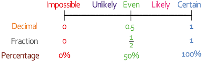

# Probability

## Introduction to Probability

* Probability is the study of chance or the likelihood of an event happening

  $$
  P(event) = \frac{\text{Number of favourable outcomes}}{\text{Total number of outcomes}}
  $$

* If probability = 0, the event is impossible

* If probability =1, the event is certain to happen

* If probability = 0.5, there is an even chance

* All probabilities lie between 0 and 1

* Probability can be written in

  * Fraction

  * Decimal

  * Percentage

    

* $P(A) = 1 - P(A')$

* $\text{Probability of A happening} = 1 - \text{Probability of A Not Happening}$