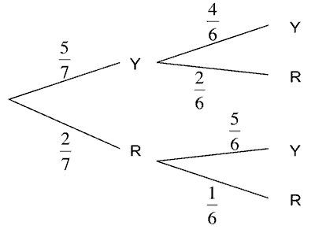

## Events

### **Exclusive Events**

- Two events are exclusive if they cannot occur at the same time\
  

Probabilities of any choice of events

### **Independent Events**

- Two events are independent if the occurrence of one is unaffected by
  occurrence of other

### **The OR Rule**

- Refers to the probability of either event happening (or both)

- **Rule:** $P(A \text{ or } B) = P(A) + P(B) - P(A \cap B)$

- If events are mutually exclusive:

  - $P(A \text{ or } B) = P(A) + P(B)$

### **The AND Rule**

- Refers to the probability of two events happening together.
- **Rule:** $P(A \text{ and } B) = P(A \cap B)$
- If events are independent:
  - $P(A \cap B) = P(A) \times P(B)$