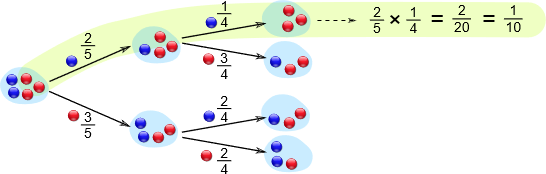

## Conditional Probability

* Calculate using Venn diagram:

* Construct the Venn diagram, using sample space of both events

  * $P(A$\|$B) = \frac{P(A \cap B)}{P(B)}$

* Calculate using tree diagrams:

  

* First branches = 1st event outcomes

* Second branches = 2nd event outcomes

* Write probabilities next to each branch

* Multiply along branches for combined probabilities

* Add if multiple paths lead to the desired outcome

* Note: The probabilities reduce with each step if objects are not replaced

**Calculate using two-way tables:**

* Column and row headers are the sample space of the two events

  * Fill in each cell with the correct number of outcomes
  * Take the required number from the table and divide by the sum of
    all values in the row/column of the condition provided.