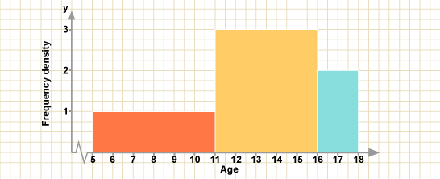

# Statistics

## Histogram

- A histogram displays frequency of continuous or grouped discrete data using bars

- Bars are joined together and may be of varying width

- Frequency of the data is represented by the area of the bar and not
  the height. When class intervals are different, area of the bar represents the frequency, not the height

- Frequency density plotted on y-axis,
  not frequency

- **Class width** = Size of Interval

- **Frequency density** = Height

$$Frequency = Class\ width \times Frequency\ density$$