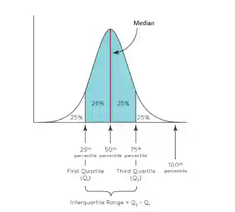

## Averages

### **Mean**

$\frac{\text{Sum of values}}{\text{number of values}}$

**Estimated Mean (Grouped Data)**

- Find the midpoint of each group,

- Multiple each midpoint by its frequency,

- Add the results and divide by the total frequency.,

$\text{Estimated Mean} = \frac{\sum (\text{Midpoint} \times \text{Frequency})}{\text{Total Frequency}}$

### **Median**

- The middle value - when the data has been written in ascending
  or descending order

- Odd No. of Values:  (n+1)/2 th value

- Example: For 5 values → (5+1)/2 = 3rd Value

- Even No. of Values:  (n)/2 and (n/2 +1)th values

- Take average of these two values

### **Mode**

- Most frequently occurring value

### **Range**

- Range = Highest Value - Lowest Value
- Quartiles

  
* Upper Quartile (Q3) -

  $$
  \frac{3}{4}(n + 1)
  $$
* Lower Quartile (Q1) -

  $$
  \frac{1}{4}(n + 1)
  $$
- n = total number of data in a set

**Modal Class Interval** - Class interval with the highest frequency